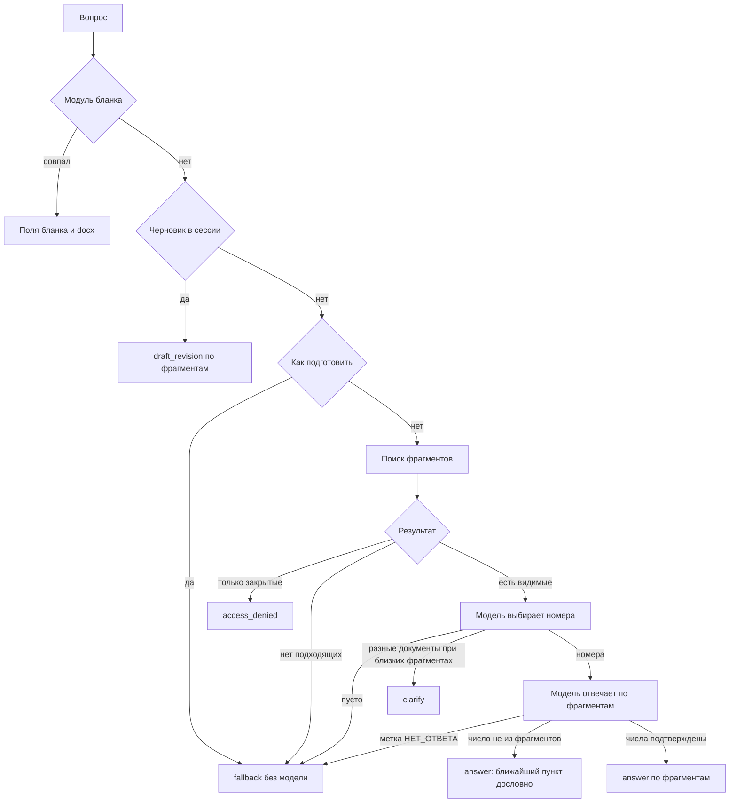

# DocsSearch

Локальный помощник по внутренним регламентам: сотрудник спрашивает своими словами, система находит пункт инструкции и объясняет его. Запросы не уходят во внешние модели. Браузер ходит только на веб, порт 3000.

## Как проходит вопрос

В боевом режиме сообщение в сессии идет по схеме ниже. Пустой процесс ищет по всем документам, а правила ответа берет у процесса «Документооборот». Выбранный процесс ограничивает поиск своими документами и своими правилами.



У чата два режима, переключатель под полем ввода. «Чтение» (по умолчанию) - только ответы по базе знаний: документы не начинаются, а на прямую просьбу подготовить документ под ответом появляется подсказка про «План». «План» - бот готовит документ: вид узнается по словам реплики (глагол «подготовь» не нужен, вопрос «как составить служебку?» тоже начинает документ), затем модель выбирает вид по смыслу просьбы, а если и она не уверена или ее нет - бот предлагает список, ответ - номер или название. Режим хранится в сессии, новый чат берет последний выбор. В «Плане» просьба («подготовь служебную записку о замене ноутбука», «нужна служебка на закупку», «напиши письмо», «составь акт», «нужен протокол») запускает макет документа: служебная, докладная и пояснительная записки, запрос на закупку, деловое письмо, акт, протокол. Бот задает наводящие вопросы (кому, от кого, о чем, суть), адресата и подписанта предлагает из вкладки «Организация», в письмо, акт и протокол вставляет герб и штамп. Модель ставит адресата в дательный падеж и пишет текст, числа сверяются с ответами, без модели документ собирается из ответов. Вопрос «как оформить ...?» идет в базу знаний, «отмена» останавливает макет. Итог - карточка с текстом и .docx. Оформление - по Инструкции по ДОУ Организации, а то, о чем она молчит, - по ГОСТ Р 7.0.97-2025: A4, поля 30/20/25/15 мм, Times New Roman 13, интервал 1,15, отступ 1,25 см, текст по ширине, номер страницы внизу справа со второй страницы, «И. И. Иванову» в адресате и «И. И. Иванов» в подписи, «Член комиссии» у каждого члена комиссии, отметка об исполнителе (инициалы, фамилия, телефон) в левом нижнем углу последней страницы. Правила не зашиты в код: они лежат в профилях `internal/layout/formats` (`instruction.json`, `gost.json`, `base.json` для отступов шаблона), у каждого правила указан пункт документа. Правило берется из первого профиля, где оно есть; `LAYOUT_FORMAT_PRIORITY` в `.env` меняет порядок (например, `gost` - ГОСТ первым). Профиль с ошибкой или без нужного правила не дает ядру запуститься. Каталог макетов и вопросы - `internal/texts/layouts.go`, сборка - `internal/layout`.

Вектор фрагмента строится по адресу (документ, раздел, пункт) и тексту. Таблица данных в .docx (например, Матрица визирования) режется по строкам: каждая ячейка подписана заголовком столбца, строка-группа становится разделом. Проверка качества: из `source/core` команда `go run ./cmd/eval`, в боевом режиме с переменными `EVAL_LOGIN` и `EVAL_PASSWORD` сотрудника.

Стандартный набор документов компании лежит в `source/docs`: при каждом запуске ядро загружает его в базу знаний, удалить эти документы нельзя, остальные документы догружаются через админ-панель. Новая редакция документа переносит прежнюю в архив редакций, архивные можно скачать из списка документов. Вопрос, который называет документ целиком («Закон о коммерческой тайне»), получает краткую справку о документе и кнопку скачивания. В чате можно выбрать сразу несколько категорий знаний, например «Документооборот» и «Финансы».

У `answer` и `fallback` есть контакты, если в базе загружен справочник подразделений. У `clarify`, `access_denied`, бланка и правки черновика этого блока нет.

## Запуск

Команды из каталога `source`.

```bash
cp .env.example .env
```

В `.env` задать `DOCS_PASSWORD`. Затем:

```bash
docker compose up -d --build
```

Открыть `http://localhost:3000`. Первая регистрация создает главного администратора.

Эмбеддинги считает `nomic-embed-text`, ответы пишет `vikhr-nemo`. Ollama по умолчанию на этой машине. Если ее нет, в `.env` указать `OLLAMA_URL=http://ollama:11434` и запустить:

```bash
docker compose --profile ollama up -d --build
```

LDAP, чистая база и проверка `healthy` описаны в [source/README.md](source/README.md).

## После входа

Администратор подтверждает сотрудников, загружает инструкции с процессом и ролями и при необходимости включает LDAP в настройках.

Ручные запросы к ядру: `http://127.0.0.1:8080/docs`, пароль `DOCS_PASSWORD`.
