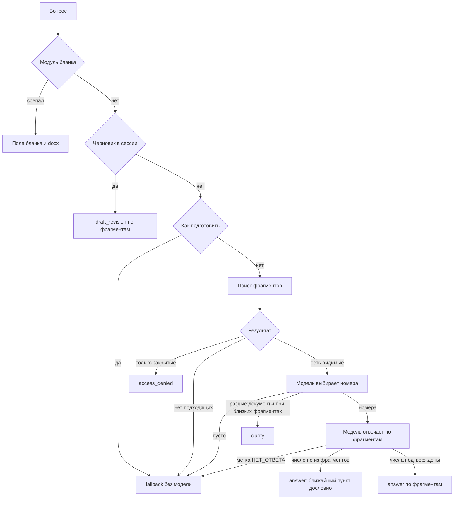

# DocsSearch

Локальный помощник по внутренним регламентам: сотрудник спрашивает своими словами, система находит пункт инструкции и объясняет его. Запросы не уходят во внешние модели. Браузер ходит только на веб, порт 3000.

## Как проходит вопрос

В боевом режиме сообщение в сессии идет по схеме ниже. Пустой процесс ищет по всем документам, а правила ответа берет у процесса «Документооборот». Выбранный процесс ограничивает поиск своими документами и своими правилами.



Вектор фрагмента строится по адресу (документ, раздел, пункт) и тексту. Проверка качества: из `source/core` команда `go run ./cmd/eval`, в боевом режиме с переменными `EVAL_LOGIN` и `EVAL_PASSWORD` сотрудника.

У `answer` и `fallback` есть контакты, если в базе загружен справочник подразделений. У `clarify`, `access_denied`, бланка и правки черновика этого блока нет.

## Запуск

Команды из каталога `source`.

```bash
cp .env.example .env
```

В `.env` задать `DOCS_PASSWORD`. Затем:

```bash
docker compose up -d --build
```

Открыть `http://localhost:3000`. Первая регистрация создает главного администратора.

Эмбеддинги считает `nomic-embed-text`, ответы пишет `vikhr-nemo`. Ollama по умолчанию на этой машине. Если ее нет, в `.env` указать `OLLAMA_URL=http://ollama:11434` и запустить:

```bash
docker compose --profile ollama up -d --build
```

LDAP, чистая база и проверка `healthy` описаны в [source/README.md](source/README.md).

## После входа

Администратор подтверждает сотрудников, загружает инструкции с процессом и ролями и при необходимости включает LDAP в настройках.

Ручные запросы к ядру: `http://127.0.0.1:8080/docs`, пароль `DOCS_PASSWORD`.
