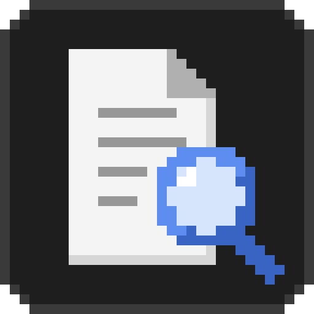
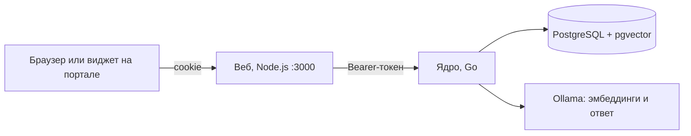
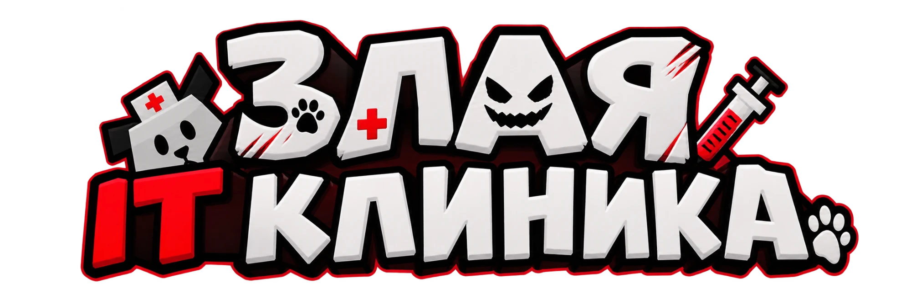

<p align="center">
  
</p>

<h1 align="center">DocsSearch</h1>

<p align="center">
  <b>Локальный помощник по внутренним документам организации</b><br>
  Go · Node.js · PostgreSQL + pgvector · Ollama
</p>

Сотрудник спрашивает своими словами («когда регистрируют входящее письмо?»), а DocsSearch находит нужный пункт инструкции, объясняет его простым языком и показывает цитату со ссылкой на оригинал. Ещё он готовит документы по бланкам и проверяет черновики по Инструкции по ДОУ.

Всё работает на ваших серверах: модель ИИ запускается локально через Ollama, вопросы и документы никуда не уходят.

## Что умеет

- **Ответы по базе знаний.** Поиск по смыслу, а не по словам, ответ только по найденным фрагментам, цитата, процент релевантности и ссылка на пункт. Если ответа в документах нет, помощник честно об этом говорит, а не выдумывает.
- **Уточнение.** Если вопрос одинаково подходит к двум документам, помощник спрашивает, о каком речь.
- **Подготовка документов** (режим «План»). Служебная, докладная и пояснительная записки, запрос на закупку, письмо, акт, протокол и модульные приказы и распоряжения. Помощник задаёт вопросы по полям и отдаёт готовый `.docx`, оформленный по Инструкции по ДОУ и ГОСТ Р 7.0.97-2025.
- **Проверка черновика и оформления.** Прикладываете в чат свой документ и получаете замечания со ссылками на пункты инструкции. У `.docx` проверяется оформление по Инструкции по ДОУ и ГОСТ Р 7.0.97-2025: поля, шрифт, интервалы, выравнивание, номер страницы, даты, инициалы и остатки шаблона. По кнопке «Исправить оформление» помощник спрашивает, кто подписывает, кому адресован документ и о чём он, сам исправляет файл, добавляет подпись, адресата, заголовок и номер страницы и отдаёт исправленный `.docx`, а что поправить вручную - перечисляет.
- **Доступ по ролям.** Общие документы видны всем или только выбранным ролям, у каждого сотрудника есть личные документы. Закрытый текст не попадает в ответ даже частично.
- **Вход для организации.** Регистрация по почте с подтверждением администратором или вход через LDAP и Active Directory, роли можно назначать по группам каталога.
- **Админ-панель.** Пользователи и роли, база знаний с архивом редакций, журнал вопросов, выбор и скачивание моделей ИИ, реквизиты организации, автозагрузка документов из папки или лицензионного API Консультант Плюс.
- **Виджет для портала.** Одна строка `<script>` добавляет кнопку чата на внутренний сайт.

## Быстрый старт

Нужны [Docker Desktop](https://www.docker.com/products/docker-desktop/) и [Ollama](https://ollama.com) с моделями (как поставить модели - в [LOCAL_AI.md](documents/LOCAL_AI.md#шаг-2-скачать-модели)). Без Ollama на машине подойдёт профиль `ollama`, см. [source/README.md](source/README.md#если-ollama-на-этой-машине-нет).

```bash
cd source
cp .env.example .env
```

Задайте в `source/.env` пароль служебной страницы ядра: `DOCS_PASSWORD=любой-пароль`. Затем:

```bash
docker compose up -d --build
```

Откройте http://localhost:3000. Первая учётная запись, созданная на сайте, становится главным администратором. Дальше: «Админ-панель» -> «База знаний» -> «Загрузить» и файлы из [source/docs](source/docs), затем вопрос в чате.

Проверить интерфейс без базы и модели: `API_MODE=stub` в `.env`, вход `admin` / `admin` или `user` / `user`.

## Как это устроено



Браузер ходит только в веб. Веб держит токен ядра у себя и пропускает в ядро только разрешённые разделы API. Ядро режет документы на фрагменты, хранит векторы в PostgreSQL, ищет подходящие фрагменты с учётом прав сотрудника и просит локальную модель ответить только по ним. Наружу открыт один порт - 3000.

## Структура репозитория

| Каталог | Что внутри |
|---|---|
| [source/core](source/core) | Ядро на Go: API, поиск, ответы, бланки, роли, хранилище |
| [source/web](source/web) | Веб на Node.js без зависимостей: чат, админ-панель, виджет |
| [source/docs](source/docs) | Стандартный набор документов, ядро загружает его при каждом запуске |
| [source/ollama](source/ollama) | Modelfile чат-модели Vikhr-Nemo-12B |
| [source/RAG](source/RAG) | Исследовательский прототип на Python: на нём подбирали нарезку, пороги и промпты для ядра |
| [source/docker-compose.yml](source/docker-compose.yml) | Весь проект одной командой |
| [documents](documents) | Второстепенные документы: локальная ИИ, проверка LDAP, правила кода, материалы кейса, логотипы |

## Документация

| Документ | Для кого и о чём |
|---|---|
| [source/README.md](source/README.md) | Запуск и обслуживание: настройки, команды, неполадки |
| [LOCAL_AI.md](documents/LOCAL_AI.md) | Ollama и модели на Windows, запуск модулей по отдельности для разработки |
| [LDAP_DEMO.md](documents/LDAP_DEMO.md) | Проверка входа через каталог на тестовом LLDAP |
| [CodeStyle.md](documents/CodeStyle.md) | Правила кода и коммитов команды |
| [source/core/README.md](source/core/README.md) | Ядро: режимы, путь вопроса, права, API |
| [source/web/README.md](source/web/README.md) | Веб: экраны, безопасность, виджет |
| [source/RAG/README.md](source/RAG/README.md) | Прототип RAG на Python |

## Ограничения

- Форматы документов: `.txt`, `.pdf` (с текстовым слоем, без распознавания сканов) и `.docx`.
- Интерфейс, ответы и оформление документов рассчитаны на русский язык.
- На процессоре без видеокарты ответ модели идёт десятки секунд. Для Vikhr-Nemo-12B нужно от 16 ГБ оперативной памяти.
- Сессии браузера хранятся в памяти веба: после его перезапуска сотрудники входят заново.
- По умолчанию сайт работает по HTTP. Для работы в сети организации поставьте перед ним HTTPS и включите `COOKIE_SECURE=true`.

## Команда

<p align="center">
  <a href="https://github.com/zlaya-it-clinika"></a>
</p>

DocsSearch сделала команда **«Злая IT клиника»** на хакатоне по кейсу Банка России.

<table align="center">
  <tr>
    <td align="center" width="160">
      <a href="https://github.com/Syharik3316"><br><b>Syharik3316</b></a><br>
      <sub>веб: чат, админ-панель, виджет</sub>
    </td>
    <td align="center" width="160">
      <a href="https://github.com/bulankov69"><br><b>bulankov69</b></a><br>
      <sub>ядро на Go</sub>
    </td>
    <td align="center" width="160">
      <a href="https://github.com/rodyaisdead"><br><b>rodyaisdead</b></a><br>
      <sub>прототип RAG, ядро</sub>
    </td>
  </tr>
</table>

Правила кода и коммитов команды - [CodeStyle.md](documents/CodeStyle.md).

## Лицензия

Код проекта распространяется по лицензии [MIT](LICENSE).

Лицензия не распространяется на чужие материалы в репозитории: документы кейса в [source/docs](source/docs) и [documents](documents), фрагменты и бланки из них в [source/RAG/data](source/RAG/data) и `source/core/internal/blank/modules`. Права на них остаются у их авторов. Модель Vikhr-Nemo-12B в репозиторий не входит и распространяется по своей лицензии Apache-2.0.
