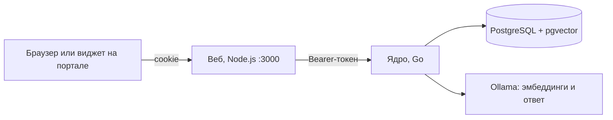

# DocsSearch

**Локальный помощник по внутренним документам организации.** Сотрудник спрашивает своими словами («когда регистрируют входящее письмо?»), а DocsSearch находит нужный пункт инструкции, объясняет его простым языком и показывает цитату со ссылкой на оригинал. Ещё он готовит документы по бланкам и проверяет черновики по Инструкции по ДОУ.

Всё работает на ваших серверах: модель ИИ запускается локально через Ollama, вопросы и документы никуда не уходят.

## Что умеет

- **Ответы по базе знаний.** Поиск по смыслу, а не по словам, ответ только по найденным фрагментам, цитата, процент релевантности и ссылка на пункт. Если ответа в документах нет, помощник честно об этом говорит, а не выдумывает.
- **Уточнение.** Если вопрос одинаково подходит к двум документам, помощник спрашивает, о каком речь.
- **Подготовка документов** (режим «План»). Служебная, докладная и пояснительная записки, запрос на закупку, письмо, акт, протокол и модульные приказы и распоряжения. Помощник задаёт вопросы по полям и отдаёт готовый `.docx`, оформленный по Инструкции по ДОУ и ГОСТ Р 7.0.97-2025.
- **Проверка черновика.** Загружаете свой документ и получаете замечания со ссылками на пункты инструкции.
- **Доступ по ролям.** Общие документы видны всем или только выбранным ролям, у каждого сотрудника есть личные документы. Закрытый текст не попадает в ответ даже частично.
- **Вход для организации.** Регистрация по почте с подтверждением администратором или вход через LDAP и Active Directory, роли можно назначать по группам каталога.
- **Админ-панель.** Пользователи и роли, база знаний с архивом редакций, журнал вопросов, выбор и скачивание моделей ИИ, реквизиты организации, автозагрузка документов из папки или лицензионного API Консультант Плюс.
- **Виджет для портала.** Одна строка `<script>` добавляет кнопку чата на внутренний сайт.

## Быстрый старт

Нужны [Docker Desktop](https://www.docker.com/products/docker-desktop/) и [Ollama](https://ollama.com) с моделями (как поставить модели - в [LOCAL_AI.md](LOCAL_AI.md), шаг 2). Без Ollama на машине подойдёт профиль `ollama`, см. [source/README.md](source/README.md#если-ollama-на-этой-машине-нет).

```bash
cd source
cp .env.example .env
```

Задайте в `source/.env` пароль служебной страницы ядра: `DOCS_PASSWORD=любой-пароль`. Затем:

```bash
docker compose up -d --build
```

Откройте http://localhost:3000. Первая учётная запись, созданная на сайте, становится главным администратором. Дальше: «Админ-панель» -> «База знаний» -> «Загрузить» и файлы из [source/docs](source/docs), затем вопрос в чате.

Проверить интерфейс без базы и модели: `API_MODE=stub` в `.env`, вход `admin` / `admin` или `user` / `user`.

## Как это устроено



Браузер ходит только в веб. Веб держит токен ядра у себя и пропускает в ядро только разрешённые разделы API. Ядро режет документы на фрагменты, хранит векторы в PostgreSQL, ищет подходящие фрагменты с учётом прав сотрудника и просит локальную модель ответить только по ним. Наружу открыт один порт - 3000.

## Структура репозитория

| Каталог | Что внутри |
|---|---|
| [source/core](source/core) | Ядро на Go: API, поиск, ответы, бланки, роли, хранилище |
| [source/web](source/web) | Веб на Node.js без зависимостей: чат, админ-панель, виджет |
| [source/docs](source/docs) | Стандартный набор документов, ядро загружает его при каждом запуске |
| [source/ollama](source/ollama) | Modelfile чат-модели Vikhr-Nemo-12B |
| [source/RAG](source/RAG) | Исследовательский прототип на Python: на нём подбирали нарезку, пороги и промпты для ядра |
| [source/docker-compose.yml](source/docker-compose.yml) | Весь проект одной командой |

## Документация

| Документ | Для кого и о чём |
|---|---|
| [source/README.md](source/README.md) | Запуск и обслуживание: настройки, команды, неполадки |
| [LOCAL_AI.md](LOCAL_AI.md) | Ollama и модели на Windows, запуск модулей по отдельности для разработки |
| [LDAP_DEMO.md](LDAP_DEMO.md) | Проверка входа через каталог на тестовом LLDAP |
| [source/core/README.md](source/core/README.md) | Ядро: режимы, путь вопроса, права, API |
| [source/web/README.md](source/web/README.md) | Веб: экраны, безопасность, виджет |
| [source/RAG/README.md](source/RAG/README.md) | Прототип RAG на Python |

## Ограничения

- Форматы документов: `.txt`, `.pdf` (с текстовым слоем, без распознавания сканов) и `.docx`.
- Интерфейс, ответы и оформление документов рассчитаны на русский язык.
- На процессоре без видеокарты ответ модели идёт десятки секунд. Для Vikhr-Nemo-12B нужно от 16 ГБ оперативной памяти.
- Сессии браузера хранятся в памяти веба: после его перезапуска сотрудники входят заново.
- По умолчанию сайт работает по HTTP. Для работы в сети организации поставьте перед ним HTTPS и включите `COOKIE_SECURE=true`.

## Команда

Проект хакатона. Ядро - PotJoke, веб - Syharik3316, прототип RAG - rodyaisdead. Правила кода и коммитов - [CodeStyle.md](CodeStyle.md).

Файла лицензии в репозитории пока нет.
