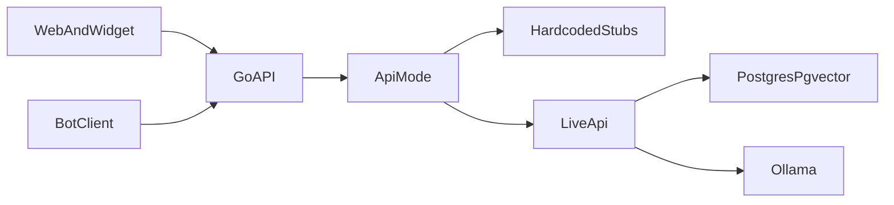

# DocsSearch

Локальный помощник по внутренним регламентам и документам. Прототип для кейса: сотрудник спрашивает своими словами, система находит положения инструкции, объясняет их простым языком и даёт ссылку на оригинал.

Исходное описание кейса лежит в [task.pdf](task.pdf).

## Задача

Сотрудник в диалоге:

- находит нужные разделы, пункты и приложения;
- получает понятное объяснение и точную цитату;
- видит процент релевантности и ссылку на оригинальный документ;
- отвечает на уточняющие вопросы, если запрос неполный;
- получает модульный бланк и заполняет его по шагам;
- загружает черновик и получает рекомендации по доработке;
- получает честный отказ, если в базе нет подходящих сведений.

Документы и запросы не уходят во внешние модели: и генерация, и эмбеддинги идут через локальную Ollama. В промпт попадают только фрагменты, которые пользователь имеет право видеть.

У документа есть редакция, и её можно заменить актуальной. Когда в материалах кейса появится матрица согласования, она загружается в базу как обычный источник и находится тем же поиском.

Конструктор собирает черновик по модульным бланкам из материалов кейса. Оформление полей берётся из бланка, в том числе если бланк ссылается на ГОСТ.

## Что входит в прототип

- RAG на Ollama: упрощённый ответ, цитата (документ, раздел, пункт, приложение), процент релевантности, ссылка на оригинал
- уточняющие вопросы и память диалога
- пользователи и уровни доступа к документам
- загрузка нового документа в базу
- конструктор бланка: вопросы по пустым полям и сборка черновика
- проверка загруженного черновика и рекомендации со ссылками на пункты
- фолбек, если подходящих фрагментов нет
- web-страница и попап-виджет на одном API
- журнал аудита: кто спросил и какие документы были показаны
- ответ без фантазий: проверка опоры на найденные фрагменты и подсказка, куда обратиться за консультацией (фаза 8)
- помощь с документами: файл бланка и черновик в `.docx` (фаза 9)
- расширение на другие процессы и новые источники данных без правки кода (фаза 10)
- конструктор ролей: главный администратор создаёт роли с флагами доступа и назначает их пользователям (фаза 11)
- помощь ИИ с черновиком: загрузить свой черновик отчёта или документа, и помощник допишет, сократит или приведёт его к требованиям инструкции (фаза 12)
- вход как в open-webui: первая регистрация создаёт администратора, регистрация по почте, подтверждение новых пользователей и вход доменной учётной записью через LDAP или Active Directory (фаза 13)

## Что откладываем

- Десктоп-клиент. После рабочего web-прототипа, тот же API, каталог [source/electron](source/electron). Стек выберем позже
- витрина отличий между редакциями
- отдельный сценарий по матрице согласования
- гибридный поиск BM25 вместе с векторами

## Стек и модули

Зафиксированный стек есть только у ядра и RAG. Стек бота, сайта, виджета и десктоп-клиента выберем позже.

Бот и сайт - тонкие клиенты одного API. Сценарий диалога, поиск и сборка ответа живут в ядре, поэтому оба клиента получают одинаковые виды ответов.



- [source/core](source/core) - HTTP API на Go. Заглушки держат данные в памяти. В боевом режиме пользователи, сессии, реестр документов и журнал лежат в PostgreSQL, эмбеддинги и фильтр по уровню доступа - в той же базе через pgvector
- [source/RAG](source/RAG) - нарезка и эмбеддинги. Подключается при замене заглушек. Go-сервис ходит в Ollama по HTTP и пишет векторы в PostgreSQL
- [source/bot](source/bot) - клиент бота. Стек не выбран
- [source/web](source/web) - страница чата и попап-виджет для внутреннего портала. Стек не выбран. Свой Docker, отдельно от ядра
- [source/electron](source/electron) - десктоп-клиент после прототипа. Стек не выбран
- Docker ядра: `Dockerfile` и `docker-compose` в [source/core](source/core), сервисы только API и PostgreSQL с pgvector
- Общий Docker всего проекта: [source/docker-compose.yml](source/docker-compose.yml) поднимает PostgreSQL, ядро и веб одной командой, Ollama по желанию. Инструкция в [source/README.md](source/README.md)
- Ollama остаётся локальным процессом. Адрес и имена моделей задаются в `.env`

Переменные `.env`:

- `DEBUG` - подробные логи одной переменной
- `API_MODE` - `stub` или `live`
- `API_PORT` - порт HTTP, по умолчанию `8080`
- `DOCS_PASSWORD` - пароль страницы `/docs`, с которой можно отправлять запросы к API
- `DATABASE_URL` - строка подключения к PostgreSQL, нужна в `live`
- `OLLAMA_URL`, `OLLAMA_CHAT_MODEL`, `OLLAMA_EMBED_MODEL` - нужны в `live`
- `OLLAMA_EMBED_DIMENSIONS` - размер вектора, по умолчанию `768`
- `STUB_SEED_USERS` - `false`: заглушка стартует без `admin` / `admin` и `user` / `user`, первая регистрация создаёт администратора. По умолчанию `true`
- `ENABLE_SIGNUP`, `DEFAULT_USER_ROLE`, `SHOW_ADMIN_DETAILS` - регистрация по почте, роль новых пользователей (`pending`, `user` или `admin`) и контакт администратора на экране ожидания. По умолчанию `true`, `pending`, `true`
- `ENABLE_LDAP`, `LDAP_SERVER_LABEL`, `LDAP_SERVER_HOST`, `LDAP_SERVER_PORT`, `LDAP_APP_DN`, `LDAP_APP_PASSWORD`, `LDAP_ATTRIBUTE_FOR_USERNAME`, `LDAP_ATTRIBUTE_FOR_MAIL`, `LDAP_SEARCH_BASE`, `LDAP_SEARCH_FILTERS`, `LDAP_USE_TLS`, `LDAP_CA_CERT_FILE`, `LDAP_VALIDATE_CERT`, `LDAP_CIPHERS` - вход через LDAP или Active Directory, имена как в open-webui

Настройки регистрации и LDAP из `.env` - только начальные значения. После «Сохранить» в админ-панели («Настройки») действуют значения из базы, как `PersistentConfig` в open-webui.

Тексты ответов и подписей лежат в отдельных файлах, не в обработчиках. Код пишем по [CodeStyle.md](CodeStyle.md): табы, комментарии на русском, идентификаторы на английском, дефис вместо длинного тире. В ядре на Go форматирование делает `gofmt`.

### Кто что делает

- ядро и замена заглушек - PotJoke
- сайт и виджет - Syharik3316, старт сразу после фазы 0
- бот - другие участники, старт сразу после фазы 0. Запись в [source/bot/README.md](source/bot/README.md), что бот ведёт PotJoke, устарела
- отдельного владельца RAG нет: модуль входит в трек API
- десктоп-клиент - общая ответственность, поздняя фаза, стек выберем позже

Фазы 2-6 идут параллельно с фазой 1. Клиенты продолжают ходить в те же эндпоинты, пока заглушки меняются на боевую реализацию. Форма ответов при этом не меняется.

Уровень доступа - целое число. Пользователь видит документ, если его уровень не ниже уровня документа. Список пользователей, создание, смена уровня и журнал доступны при уровне 2 и выше.

## Контракт API

Базовый префикс сервера задаёт окружение клиентов. Авторизация: заголовок `Authorization: Bearer <token>`. Поле `token` - случайная строка. В `stub` она живёт до перезапуска процесса, в `live` хранится в PostgreSQL.

Ошибки, одинаковые для `stub` и `live`:

- `401` и `{"error":"invalid_credentials"}` - неверная пара почты (логина) и пароля, в том числе для входа через LDAP
- `401` и `{"error":"unauthorized"}` - нет заголовка или токен неизвестен
- `403` и `{"error":"access_denied"}` - уровень ниже нужного, чужая сессия или закрытый файл
- `404` и `{"error":"not_found"}` - нет такой сессии, пользователя или документа
- `403` и `{"error":"account_pending"}` - учётная запись ждёт подтверждения администратором. Открыты только `/me`, `/auth/logout` и `/auth/admin/details`
- `403` и `{"error":"signup_disabled"}` - регистрация выключена в настройках
- `403` и `{"error":"ldap_disabled"}` - вход через LDAP выключен
- `400` и `{"error":"invalid_email"}` - почта при регистрации не похожа на адрес
- `400` и `{"error":"ldap_email_missing"}` - у записи в каталоге нет почты
- `502` и `{"error":"ldap_unavailable"}` - сервер LDAP не отвечает, служебная учётная запись не вошла или настройки неверны
- `409` и `{"error":"login_taken"}` - почта (логин) уже занята
- `400` и `{"error":"invalid_body"}` - тело запроса не разбирается или тип файла не `.txt`, `.pdf`, `.docx`
- `400` и `{"error":"embed_size_mismatch"}` - Ollama вернула вектор другого размера, чем `OLLAMA_EMBED_DIMENSIONS`
- `502` и `{"error":"embed_unavailable"}` - эмбеддинг не посчитан
- `500` и `{"error":"store_unavailable"}` - сбой записи в PostgreSQL

Локальным клиентам сервер отвечает с CORS на любой origin и разрешает заголовки `Authorization` и `Content-Type`.

### Вход, регистрация и роли

Устроено как в open-webui. Учётных записей при первом запуске нет. Первая регистрация создаёт администратора со всеми правами, даже если регистрация выключена. Дальше по почте регистрируются сотрудники и получают роль по умолчанию. Администратор выключает регистрацию, меняет роль по умолчанию и настраивает LDAP во вкладке «Настройки» админ-панели.

Роли:

- `admin` - уровень 2, админ-панель
- `user` - уровень 1
- `pending` - ждёт подтверждения: вход проходит, но все методы, кроме профиля и выхода, отвечают `403 account_pending`. Клиент показывает экран «Учётная запись ожидает активации». Администратор подтверждает роль в списке пользователей

Свою роль администратор не меняет (`403 access_denied`), поэтому без администратора система не останется.

Почта служит логином и сравнивается без учёта регистра. Учётные записи, созданные до регистрации по почте, входят по старому логину через то же поле.

### `GET /auth/config`

Без токена. Что показать на экране входа:

```json
{ "onboarding": true, "enableSignup": true, "enableLdap": false, "ldapLabel": "LDAP" }
```

`onboarding` равен `true`, пока в системе нет ни одной учётной записи.

### `POST /auth/signup`

Без токена. Ответ - как у `POST /auth/login`, сразу с токеном.

```json
{ "email": "ivanov@corp.local", "password": "secret", "displayName": "Иванов Иван" }
```

Пароль до 72 байт, как у bcrypt. Занятая почта - `409 login_taken`, выключенная регистрация - `403 signup_disabled`.

### `POST /auth/login`

Запрос:

```json
{ "login": "ivanov@corp.local", "password": "secret" }
```

Вместо `login` можно передать `email`. Ответ:

```json
{
  "token": "a1b2c3d4e5f67890",
  "userId": "user-1",
  "login": "ivanov@corp.local",
  "displayName": "Иванов Иван",
  "accessLevel": 1,
  "role": "user"
}
```

Значение `token` в примере условное: на каждом входе сервер выдаёт новое.

### `POST /auth/ldap`

Без токена. Вход доменной учётной записью, ответ - как у `POST /auth/login`.

```json
{ "login": "ivanov", "password": "secret" }
```

Шаги как в open-webui: служебная учётная запись (`appDn`) ищет пользователя фильтром `(&(<атрибут логина>=<логин>)<фильтры поиска>)` в базе поиска, затем каталог проверяет его пароль входом под найденным DN. Логин в фильтре экранируется. Пустой пароль отклоняется сразу: Active Directory считает его анонимным входом и отвечает успехом.

Доменная учётная запись привязывается к локальной по почте из атрибута почты. Если локальной ещё нет, она создаётся с ролью по умолчанию (первая в системе - администратор). Флаг регистрации здесь не действует, как в open-webui: кого пускать, решают фильтры поиска, например членство в группе.

### `GET /me`

Тот же объект пользователя, без поля `token`. Работает и для `pending`. `role` равен `pending`, если учётная запись ждёт подтверждения, `admin`, если уровень не ниже 2, иначе `user`.

### `GET /auth/admin/details`

Имя и почта первого администратора для экрана ожидания: `{ "name": "...", "email": "..." }`. Доступен и для `pending`. Если в настройках контакт скрыт - `404 not_found`.

### `GET /auth/admin/config` и `POST /auth/admin/config`

Регистрация и роль по умолчанию. Нужен администратор. `POST` принимает любую часть полей и отвечает сохранённым объектом.

```json
{ "enableSignup": true, "defaultUserRole": "pending", "showAdminDetails": true }
```

### `GET /auth/admin/config/ldap` и `POST /auth/admin/config/ldap`

Включён ли вход через LDAP: `{ "enableLdap": true }`. Нужен администратор.

### `GET /auth/admin/config/ldap/server` и `POST /auth/admin/config/ldap/server`

Подключение к каталогу. Нужен администратор. Обязательные поля: `label`, `host`, `attributeForMail`, `attributeForUsername`, `searchBase`.

```json
{
  "label": "Active Directory",
  "host": "dc01.corp.local",
  "port": 636,
  "attributeForMail": "mail",
  "attributeForUsername": "sAMAccountName",
  "appDn": "CN=svc-docssearch,OU=Service,DC=corp,DC=local",
  "appDnPassword": "",
  "appDnPasswordSet": true,
  "searchBase": "OU=Users,DC=corp,DC=local",
  "searchFilters": "(objectClass=user)",
  "useTls": true,
  "certificatePath": "/certs/corp-ca.pem",
  "validateCert": true,
  "ciphers": "ALL"
}
```

- `port` `0` - 389, с `useTls` - 636
- `useTls` - LDAPS. `certificatePath` - файл PEM с CA на машине ядра, `validateCert` - проверка сертификата, `ciphers` - `ALL` или имена шифров Go через двоеточие
- `appDnPassword` наружу не отдаётся: в ответе всегда пусто, а `appDnPasswordSet` говорит, сохранён ли пароль. Пустой `appDnPassword` в `POST` оставляет прежний пароль, пустой `appDn` - анонимный поиск без пароля

### `POST /auth/logout`

Заголовок `Authorization: Bearer <token>`. Токен перестаёт действовать. Ответ без тела, статус `204`. Неизвестный токен - `401`.

### `POST /sessions`

Ответ:

```json
{ "sessionId": "session-1" }
```

Сессия принадлежит вошедшему пользователю.

### `GET /sessions`

Список сессий текущего пользователя, сначала недавно обновлённые:

```json
{
  "canRename": true,
  "canDelete": true,
  "sessions": [
    {
      "sessionId": "session-1",
      "title": "Как зарегистрировать входящий документ?",
      "createdAt": "2026-10-23T12:00:00Z",
      "updatedAt": "2026-10-23T12:05:00Z"
    }
  ]
}
```

`title` - первый вопрос сессии, не длиннее 60 символов, пока пользователь не переименовал чат. У пустой сессии заголовок пустой.

`canRename` и `canDelete` - может ли пользователь переименовывать и удалять свои сессии. Клиент показывает эти пункты меню чата только при `true`.

### `PATCH /sessions/{sessionId}`

Переименование своей сессии:

```json
{ "title": "Регистрация входящих" }
```

Ответ - объект сессии, как элемент списка `GET /sessions`. Пустой `title` или длиннее 120 символов - `400 invalid_body`. Чужая сессия - `403 access_denied`, нет сессии - `404 not_found`.

### `DELETE /sessions/{sessionId}`

Удаление своей сессии вместе с историей. Ответ `204` без тела. Записи журнала аудита остаются. Чужая сессия - `403 access_denied`, нет сессии - `404 not_found`.

### `GET /sessions/{sessionId}`

История этой сессии. Реплика пользователя содержит `role` и `text`. Ответ ассистента содержит те же поля, что `POST .../messages`, плюс `role: "assistant"`.

```json
{
  "sessionId": "session-1",
  "messages": [
    {
      "role": "user",
      "text": "Как зарегистрировать входящий документ?"
    },
    {
      "role": "assistant",
      "kind": "answer",
      "text": "Входящий документ регистрируют в день поступления и присваивают ему номер.",
      "relevancePercent": 86,
      "citations": []
    }
  ]
}
```

### `POST /sessions/{sessionId}/messages`

Запрос:

```json
{ "text": "Как зарегистрировать входящий документ?" }
```

Ответ ассистента. Поле `kind`:

- `answer` - объяснение, цитаты, процент релевантности
- `clarify` - уточняющий вопрос
- `fallback` - в базе нет подходящих сведений
- `template_field` - вопрос по очередному полю бланка
- `template_ready` - черновик собран
- `access_denied` - на найденные документы не хватает уровня доступа

Пример `answer`:

```json
{
  "kind": "answer",
  "text": "Входящий документ регистрируют в день поступления и присваивают ему номер.",
  "relevancePercent": 86,
  "citations": [
    {
      "document": "Инструкция по документообороту",
      "edition": "1.0",
      "section": "3",
      "paragraph": "3.2",
      "appendix": "",
      "quote": "Точная цитата из пункта инструкции.",
      "originalLink": "/documents/doc-1/file#p3.2",
      "documentId": "doc-1",
      "scope": "global"
    }
  ]
}
```

`documentId` и `scope` в цитате нужны, чтобы клиент пометил ответ из личного документа. Если ядро их не отдаёт, цитата считается общей.

Пример `template_field`:

```json
{
  "kind": "template_field",
  "text": "Укажите адресата.",
  "relevancePercent": 0,
  "citations": [],
  "template": {
    "id": "memo",
    "title": "Служебная записка",
    "field": "addressee",
    "fieldLabel": "Адресат"
  }
}
```

Пример `template_ready`:

```json
{
  "kind": "template_ready",
  "text": "Черновик собран.",
  "relevancePercent": 0,
  "citations": [],
  "template": {
    "id": "memo",
    "title": "Служебная записка",
    "draftText": "Текст черновика."
  }
}
```

У `clarify`, `fallback` и `access_denied` те же поля `text`, `relevancePercent` и `citations`. Для отказа и фолбека список цитат пустой, процент равен 0.

### Общие и личные документы

База знаний одна, у каждого документа есть область `scope`:

- `global` - общий документ. Загружает, меняет и удаляет только администратор. Видят сотрудники с уровнем не ниже `accessLevel` документа
- `personal` - личный документ сотрудника. Загружает любой пользователь для себя. Видят владелец и администраторы, удаляют они же

Поиск для ответа в чате идёт по общим документам в пределах уровня пользователя и по его собственным личным документам:

```sql
WHERE (scope = 'global' AND access_level <= :userLevel)
   OR (scope = 'personal' AND owner_id = :userId)
```

Чужие личные документы в выдачу чата не попадают никогда, в том числе у администратора: он видит их только в списке документов.

Ядро само сообщает клиенту, что разрешено текущему пользователю: флаги `canUploadGlobal`, `canUploadPersonal` в списке и `canDelete` у каждого документа. Клиент показывает только разрешённые действия, поэтому при новых правилах доступа менять клиентов не нужно.

### `POST /documents`

Загрузка документа в базу знаний: `multipart/form-data`, поле `file`. Форматы `.txt`, `.pdf`, `.docx`. Необязательные поля:

- `title`, `edition`
- `scope` - `global` или `personal`. По умолчанию `global` для администратора и `personal` для пользователя. `global` от пользователя - `403 access_denied`
- `accessLevel` - только для `global`, у личного документа игнорируется

Ответ:

```json
{
  "documentId": "doc-1",
  "status": "accepted",
  "edition": "1.0",
  "scope": "global"
}
```

Повторная загрузка с тем же названием заменяет актуальную редакцию. Название уникально внутри области: среди общих документов и среди личных документов одного владельца. В заглушке файл не индексируется, но запись появляется в списке.

### `GET /documents`

Документы, которые текущий пользователь имеет право видеть: общие в пределах его уровня и свои личные. Параметр `?scope=global` или `?scope=personal` сужает список.

Параметр `?scope=all` - только для администратора: все общие документы и личные документы всех сотрудников. От пользователя - `403 access_denied`.

```json
{
  "canUploadGlobal": true,
  "canUploadPersonal": true,
  "documents": [
    {
      "documentId": "doc-1",
      "title": "Инструкция по документообороту",
      "edition": "1.0",
      "accessLevel": 1,
      "scope": "global",
      "ownerId": "",
      "ownerName": "",
      "uploadedAt": "2026-10-23T14:00:00Z",
      "canDelete": true
    },
    {
      "documentId": "doc-7",
      "title": "Памятка отдела",
      "edition": "1.0",
      "accessLevel": 1,
      "scope": "personal",
      "ownerId": "user-1",
      "ownerName": "Сотрудник",
      "uploadedAt": "2026-10-23T15:10:00Z",
      "canDelete": true
    }
  ]
}
```

### `GET /documents/{documentId}/file`

Файл оригинала. В цитатах `originalLink` ведёт на этот путь, якорь пункта остаётся фрагментом: `/documents/doc-1/file#p3.2`. Общий документ отдаётся по уровню доступа, личный - владельцу и администраторам. Чужой личный документ для пользователя - `404 not_found`, чтобы не раскрывать, что он существует.

### `DELETE /documents/{documentId}`

Удаляет документ и все его фрагменты из поиска. Общий - только администратор, личный - владелец или администратор. Ответ `204` без тела. Нет прав - `403 access_denied`, чужой личный документ для пользователя - `404 not_found`.

### `GET /users`

Список учётных записей от старых к новым. Нужен уровень 2 или выше.

```json
{
  "users": [
    {
      "userId": "user-1",
      "login": "ivanov@corp.local",
      "displayName": "Иванов Иван",
      "accessLevel": 1,
      "role": "user",
      "createdAt": "2026-10-24T09:00:00Z"
    }
  ]
}
```

### `POST /users`

Создание учётной записи администратором. Нужен уровень 2 или выше. Пароль в ответ не входит.

Запрос:

```json
{
  "login": "clerk@corp.local",
  "password": "clerk",
  "displayName": "Делопроизводитель",
  "role": "user"
}
```

`role` - `pending`, `user` или `admin`. Без `role` можно передать `accessLevel`, как раньше. Вместо `login` можно передать `email`. Ответ - объект пользователя, как элемент списка `GET /users`.

### `PATCH /users/{userId}`

Смена `displayName`, `login` (или `email`), `password`, `role` и `accessLevel`. Нужен уровень 2 или выше. Можно передать любую часть полей. `role` задаёт и уровень, и ожидание подтверждения. Свою роль сменить нельзя - `403 access_denied`.

```json
{ "displayName": "Сотрудник архива", "role": "user" }
```

Ответ - обновлённый объект пользователя.

### `GET /audit`

Журнал от старых записей к новым. Нужен уровень 2 или выше. Каждое сообщение в сессии добавляет строку: кто спросил, текст, время, какие документы показаны.

```json
{
  "entries": [
    {
      "entryId": "audit-1",
      "userId": "user-1",
      "displayName": "Сотрудник",
      "question": "Как зарегистрировать входящий документ?",
      "createdAt": "2026-10-23T14:00:00Z",
      "documents": [
        {
          "documentId": "doc-1",
          "title": "Инструкция по документообороту",
          "paragraph": "3.2",
          "scope": "global"
        }
      ]
    }
  ]
}
```

### `POST /drafts/check`

Проверка черновика: `multipart/form-data`, поле `file`.

Ответ:

```json
{
  "recommendations": [
    {
      "text": "В проекте нет отметки о приложении.",
      "citation": {
        "document": "Инструкция по документообороту",
        "edition": "1.0",
        "section": "4",
        "paragraph": "4.1",
        "appendix": "",
        "quote": "Точная цитата требования.",
        "originalLink": "/documents/doc-1/file#p4.1",
        "documentId": "doc-1",
        "scope": "global"
      }
    }
  ]
}
```

## Режим заглушек

При `API_MODE=stub` сервер не вызывает Ollama и не читает базу. Сессии, документы, пользователи, журнал и настройки входа лежат в памяти, пока жив процесс. После перезапуска остаются две учётные записи и два документа:

- `admin` / `admin`, `userId` `user-admin`, уровень 2
- `user` / `user`, `userId` `user-1`, уровень 1
- `doc-1` - «Инструкция по документообороту», уровень 1
- `doc-2` - «Закрытый регламент», уровень 2

С `STUB_SEED_USERS=false` учётных записей нет, и первый вход идёт через регистрацию администратора, как в боевом режиме. Регистрация, роль `pending` и настройки входа работают так же, как в `live`. Вход через LDAP в заглушке настоящий: её можно направить на рабочий каталог.

В боевом режиме учётные записи `admin` / `admin` и `user` / `user` больше не создаются. В базе, где они уже есть, они остаются, и первый запуск не показывается.

Вид ответа на сообщение выбирается фразой, регистр не важен:

- текст содержит `нет доступа` - `access_denied`
- текст содержит `не найдено` - `fallback`, если в этой сессии не заполняется бланк
- текст содержит `уточни` - `clarify`
- запрос, в котором узнается заголовок модуля, начинает бланк: дальше каждая реплика заполняет пустое поле, последняя собирает `draftText`. Слово `шаблон` само по себе бланк не открывает
- любое другое сообщение - `answer` с фиксированными цитатой, ссылкой и процентом релевантности

`POST /drafts/check` сверяет текст файла с инструкцией. Если нет отметки о приложении или подписи, в ответе рекомендация с цитатой и ссылкой на пункт. Файл, где оба реквизита есть, возвращает пустой список. Другой тип файла - `400 invalid_body`.

Запуск из каталога [source/core](source/core): скопировать `.env.example` в `.env`, задать `DOCS_PASSWORD` и выполнить `go run ./cmd/api`. Страница проверки запросов: `/docs`.

Для показа жюри нужен `API_MODE=live`, PostgreSQL и локальная Ollama. Ответы `answer`, `clarify` и `fallback` собираются из найденных фрагментов. Конструктор бланка и проверка черновика работают в обоих режимах. В боевом режиме ссылка проверки ведёт на видимый документ, в названии которого есть «инструкц».

## Фазы

Контракт выше появляется целиком в фазе 0. В фазах 2-6 меняется только реализация, формы ответов остаются прежними.

Фазы 8-12 закрывают основные и дополнительные функции из кейса, которых не было в первом плане. Они идут параллельно, новые поля и методы сначала описываются в контракте этого README, затем делаются в ядре и клиентах. В сдачу попадает то, что готово к фазе 7.

### Фаза 0. Заглушки ядра

Цель: отдать боту и сайту стабильные эндпоинты, пока делается боевой API.

Объём: Go-сервер в [source/core](source/core). Кто: PotJoke.

- [x] Сервер отдаёт контракт из этого README
- [x] Заглушки `answer`, `clarify`, `fallback`, `template_field`, `template_ready`, `access_denied`
- [x] История сессии, список документов и файл оригинала
- [x] Пользователи и журнал аудита
- [x] При `API_MODE=live` методы отвечают `501`
- [x] Страница `/docs` закрыта паролем `DOCS_PASSWORD`

### Фаза 1. Клиенты

Цель: собрать интерфейсы демо на фиктивных данных.

Объём: клиенты ходят только в контракт фазы 0. Фаза идёт параллельно с фазами 2-6. Кто: сайт и виджет - Syharik3316, бот - другие участники.

- [x] Страница чата в [source/web](source/web)
- [x] Попап-виджет для внутреннего портала
- [ ] Клиент бота в [source/bot](source/bot)
- [x] Отдельный Docker сайта в [source/web](source/web): свой compose, без контейнеров ядра

### Фаза 2. База знаний

Цель: заменить заглушку загрузки живой индексацией.

Объём: инструкция и бланки попадают в PostgreSQL. Кто: PotJoke.

- [x] PostgreSQL для пользователей, сессий, реестра документов и журнала
- [x] Расширение pgvector для эмбеддингов и фильтра по уровню доступа
- [x] Docker ядра в [source/core](source/core): `Dockerfile` и `docker-compose` только с API и PostgreSQL
- [x] Нарезка файлов на фрагменты с метаданными: документ, редакция, раздел, пункт, приложение, уровень доступа
- [x] Эмбеддинги через локальную Ollama
- [x] Повторная загрузка с тем же названием меняет актуальную редакцию
- [x] `POST /documents` в боевом режиме индексирует файл, и он находится поиском

### Фаза 3. Боевой ответ

Цель: заменить заглушки `answer`, `clarify` и `fallback`.

Объём: ответ собирается только из найденных фрагментов. Кто: PotJoke.

- [x] Обычный вопрос возвращает пересказ, цитату, процент релевантности и ссылку на оригинал
- [x] Неоднозначный вопрос получает `clarify`
- [x] Вопрос вне базы получает `fallback` и не достраивает факты
- [x] Сессия помнит предыдущие реплики
- [ ] Меню чата: `PATCH /sessions/{sessionId}` с `title`, `DELETE /sessions/{sessionId}`, флаги `canRename` и `canDelete` в `GET /sessions`

### Фаза 4. Доступ и аудит

Цель: заменить постоянных пользователей заглушки учётом ролей в PostgreSQL.

Объём: фильтр выдачи до сборки промпта и запись показанных документов. Кто: PotJoke.

- [x] Учётные записи и уровни доступа читаются из PostgreSQL
- [x] В промпт попадают только фрагменты не выше уровня пользователя
- [x] `access_denied`, когда подходящие фрагменты есть только в закрытых документах
- [x] Два пользователя с разным уровнем получают разную выдачу на один вопрос
- [x] Журнал пишет, кто спросил и какие документы показаны
- [x] Документы с областью `global` и `personal`: поля `scope`, `owner_id`, `uploaded_at` в `documents`, область и владелец у фрагментов для фильтра поиска
- [x] Поиск по общим документам в пределах уровня и по своим личным, без чужих личных
- [x] `GET /documents` с `?scope=` и флагами `canUploadGlobal`, `canUploadPersonal`, `canDelete`
- [x] `DELETE /documents/{documentId}` вместе с фрагментами
- [x] `documentId` и `scope` в цитатах и в журнале

### Фаза 5. Конструктор

Цель: заменить заглушки `template_field` и `template_ready`.

Объём: черновик собирается по модульному бланку. Кто: PotJoke.

- [x] По запросу находится подходящий бланк
- [x] Система задаёт вопросы по пустым полям
- [x] После ответов отдаёт `draftText`

### Фаза 6. Проверка черновика

Цель: заменить фиксированные рекомендации `POST /drafts/check`.

Объём: загруженный проект сверяется с инструкцией. Кто: PotJoke.

- [x] Черновик с пропуском обязательного реквизита получает рекомендацию
- [x] У рекомендации есть цитата и ссылка на пункт

### Фаза 7. Сдача

Цель: закрыть обязательные материалы защиты.

Объём: тексты пишет вся команда по своим модулям. Десктоп-клиент в эту фазу не входит.

- [ ] Описание архитектуры и стека ядра и RAG
- [ ] Пользовательские сценарии
- [ ] Схема работы с инструкцией и базой
- [ ] Описание поиска и формирования ответа
- [ ] Способы снижения ошибочных ответов
- [ ] Подход к доступу и защите данных
- [ ] Как подключать новые инструкции и бланки
- [ ] Сценарий демонстрации ниже проходит на `API_MODE=live`

### Фаза 8. Ответ без фантазий и куда обратиться

Цель: основная функция кейса «не фантазировать» и цель кейса «понять, куда обратиться, если нужна консультация».

Объём: проверка ответа модели и справочник ответственных. Кто: ядро - PotJoke, сайт - Syharik3316.

- [ ] Ядро: ответ строится только по найденным фрагментам с явной проверкой. Например, режим grounded RAG у Vikhr: модель сначала возвращает номера подходящих фрагментов, затем отвечает только по ним. Пустой список - `fallback`
- [ ] Ядро: в ответе сложные формулировки и термины инструкции объясняются простыми словами, цитата остаётся дословной
- [ ] Ядро: справочник ответственных подразделений и контактов загружается как обычный документ базы. В `answer` и `fallback` поле `contacts`: подразделение и способ связи для консультации по теме вопроса
- [ ] Сайт: блок «Куда обратиться» под ответом и в честном отказе
- [ ] Ядро: набор контрольных вопросов из примеров пользовательских запросов кейса с ожидаемыми пунктами инструкции и скрипт, который считает, сколько ответов нашли верный пункт и сколько ушли в `fallback`

### Фаза 9. Помощь с документами

Цель: основная функция кейса «помогать с документами» сверх конструктора фазы 5.

Объём: выдача бланка и готового черновика файлом. Кто: ядро - PotJoke, сайт - Syharik3316.

- [ ] Ядро: в `template_field` и `template_ready` поле `template.fileLink` - ссылка на исходный модульный бланк, как `originalLink` у цитаты
- [ ] Ядро: черновик выгружается в `.docx` с оформлением бланка: `template.draftLink` в `template_ready` и метод скачивания файла черновика
- [ ] Ядро: на вопрос «как подготовить документ» ответ перечисляет обязательные реквизиты и шаги со ссылками на пункты инструкции
- [ ] Сайт: кнопки «Скачать бланк» и «Скачать .docx» в карточке бланка и черновика

### Фаза 10. Другие процессы и новые источники данных

Цель: дополнительная функция кейса - расширение на вопросы по другим процессам, не только документообороту, и подключение новых источников.

Объём: процесс как свойство документа и подключаемые источники. Кто: ядро - PotJoke, сайт - Syharik3316.

- [ ] Ядро: у документа поле `process` (документооборот, кадры, закупки и так далее). Справочник процессов `GET /processes`, администратор добавляет новые без правки кода
- [ ] Ядро: поиск ограничивается процессом, если пользователь его выбрал, иначе идёт по всем
- [ ] Ядро: системный промпт и правила ответа хранятся у процесса в базе, а не в коде
- [ ] Ядро: извлечение текста через общий интерфейс источника. Новый формат или источник (папка на сетевом диске, выгрузка из СЭД, страницы портала) добавляется отдельным адаптером
- [ ] Ядро: пакетный импорт папки документов с указанием процесса, редакции и уровня доступа
- [ ] Сайт: выбор процесса в чате и при загрузке документа, фильтр по процессу в «Документах» и «Базе знаний», управление процессами в админ-панели

### Фаза 11. Конструктор ролей и флагов доступа

Цель: дополнительная функция кейса - настройка уровней доступа и ролевой модели. Вместо двух жёстких уровней главный администратор сам собирает роли из флагов доступа и назначает их пользователям.

Объём: каталог флагов, роли, назначение ролей, доступ к документам по ролям. Кто: ядро - PotJoke, сайт - Syharik3316.

Как устроено:

- Главный администратор - системная роль. Создаётся при первом запуске, имеет все флаги, её нельзя удалить или ограничить, и в системе всегда остаётся хотя бы один её владелец
- Флаг доступа - одно право. Каталог флагов задаёт ядро, интерфейс показывает его с описаниями. Набор флагов:
  - `chat.use` - задавать вопросы помощнику
  - `documents.personal.upload` - загружать личные документы
  - `documents.global.manage` - загружать, обновлять и удалять общие документы
  - `documents.personal.view_all` - видеть и удалять личные документы сотрудников
  - `drafts.check` - проверка готового документа по инструкции
  - `drafts.assist` - помощь ИИ с черновиком (фаза 12)
  - `templates.use` - конструктор бланков
  - `users.manage` - создавать пользователей и назначать им роли
  - `roles.manage` - создавать, менять и удалять роли
  - `audit.view` - журнал вопросов и журнал изменений прав
- Роль - название, описание и набор флагов. Пользователю назначается одна или несколько ролей, его права - объединение флагов всех его ролей
- Доступ к общему документу задаётся списком ролей, которым он виден, или «всем сотрудникам». Это заменяет числовой `accessLevel` и тот же список работает как фильтр поиска до сборки промпта
- Переход со старой модели: уровень 2 становится ролью «Администратор» со всеми флагами, кроме `roles.manage`, уровень 1 - ролью «Сотрудник» с `chat.use`, `documents.personal.upload`, `drafts.check`, `drafts.assist`, `templates.use`. Главным администратором становится первая учётная запись, созданная при первом запуске (фаза 13)

Задачи:

- [ ] Ядро: таблицы `roles`, `role_permissions`, `user_roles`, `document_roles`, миграция со старых уровней
- [ ] Ядро: `GET /permissions` - каталог флагов с названиями и описаниями для интерфейса
- [ ] Ядро: `GET /roles`, `POST /roles`, `PATCH /roles/{roleId}`, `DELETE /roles/{roleId}` по флагу `roles.manage`. Системную роль главного администратора менять и удалять нельзя, роль с пользователями удаляется только после переназначения
- [ ] Ядро: `PATCH /users/{userId}` принимает `roleIds`. Нельзя снять последнего главного администратора
- [ ] Ядро: `GET /me` отдаёт `roles` и итоговый список `permissions`, каждый метод API проверяет нужный флаг
- [ ] Ядро: у общего документа `roleIds` или признак «всем сотрудникам», поиск фильтрует фрагменты по ролям пользователя
- [ ] Ядро: журнал изменений прав: кто, кому и когда назначил или снял роль, кто изменил флаги роли
- [ ] Сайт: вкладка «Роли» в админ-панели: список ролей, конструктор роли с флагами по группам и описаниями, число пользователей у роли
- [ ] Сайт: назначение ролей в таблице пользователей, выбор ролей документа при загрузке вместо «Все сотрудники» и «Только администраторы»
- [ ] Сайт: весь интерфейс показывает разделы и действия по `permissions` из `GET /me`, а не по названию роли

### Фаза 12. Помощь ИИ с черновиком

Цель: сотрудник загружает свой черновик отчёта или документа, а помощник помогает его дописать, сократить, переформулировать или привести к требованиям инструкции. Фаза 6 только перечисляет замечания, здесь ИИ работает с текстом самого черновика.

Объём: вложение в сессии чата и ответ с переработанным текстом. Кто: ядро - PotJoke, сайт - Syharik3316.

Как устроено:

- Черновик прикрепляется к сессии чата и виден только её владельцу. В общую базу знаний он не попадает и в поиск других сотрудников не входит
- Дальше сотрудник пишет обычным текстом: «допиши раздел с выводами», «сократи до одной страницы», «оформи по инструкции», «проверь реквизиты». Модель получает текст черновика, вопрос и найденные фрагменты инструкции
- Ответ - новый вид `draft_revision`: что изменено и почему, со ссылками на пункты инструкции, и новый текст черновика целиком. Следующие просьбы в той же сессии продолжают работу с последней версией
- Черновик обрабатывается той же локальной моделью, наружу ничего не уходит

Задачи:

- [ ] Ядро: `POST /sessions/{sessionId}/attachments` - `multipart/form-data`, поле `file`, форматы `.txt`, `.pdf`, `.docx`. Ответ `{ "attachmentId": "att-1", "fileName": "...", "characters": 12000 }`. Нужен флаг `drafts.assist`
- [ ] Ядро: `POST /sessions/{sessionId}/messages` принимает необязательный `attachmentIds`, история сессии показывает вложения у реплики пользователя
- [ ] Ядро: вид ответа `draft_revision`: `text` - что сделано, `citations` - пункты инструкции, `draft` - `{ "attachmentId", "title", "draftText", "changes": [{ "text", "citation" }] }`
- [ ] Ядро: длинный черновик делится на части, чтобы не выйти за окно контекста модели, а результат собирается обратно
- [ ] Ядро: выгрузка переработанного черновика в `.docx` - `draft.draftLink`
- [ ] Ядро: вложения удаляются вместе с сессией
- [ ] Сайт: кнопка «+» в чате предлагает два действия: «Проверить по инструкции» (фаза 6) и «Помочь с черновиком». Вложение видно над полем ввода и в реплике
- [ ] Сайт: карточка `draft_revision`: список изменений со ссылками на пункты, новый текст, кнопки «Копировать», «Скачать .docx», «Продолжить править»
- [ ] Сайт: подсказки быстрых действий над черновиком: «Дописать», «Сократить», «Оформить по инструкции»

### Фаза 13. Первый запуск, регистрация и вход через LDAP

Цель: вход как в open-webui. Без фиксированных учётных записей, с регистрацией по почте, ролью по умолчанию, подтверждением новых пользователей и доменными учётными записями компании.

Объём: ядро, веб и виджет. Кто: Syharik3316.

- [x] Ядро: учётных записей по умолчанию в `live` нет, первая регистрация создаёт администратора под блокировкой PostgreSQL, чтобы две одновременные регистрации не стали администраторами
- [x] Ядро: `GET /auth/config`, `POST /auth/signup`, вход по почте без учёта регистра
- [x] Ядро: роль `pending` и ответ `account_pending` на всё, кроме профиля, выхода и контакта администратора
- [x] Ядро: настройки регистрации и LDAP в таблице `app_settings`, значения из `.env` начальные
- [x] Ядро: `POST /auth/ldap` на `go-ldap`: служебная учётная запись, поиск с экранированием логина, проверка пароля входом под DN, LDAPS с своим CA, проверкой сертификата и шифрами
- [x] Ядро: `PATCH /users/{userId}` меняет почту, пароль и роль, свою роль сменить нельзя
- [x] Ядро: заглушка повторяет поведение `live`, `STUB_SEED_USERS=false` для проверки первого запуска
- [x] Сайт: экран входа с режимами «Вход», «Регистрация», «Продолжить через LDAP» и первым запуском, способ входа запоминается в браузере
- [x] Сайт: экран «Учётная запись ожидает активации» с контактом администратора и кнопкой «Проверить снова», в чате и в виджете
- [x] Сайт: вкладка «Настройки» в админ-панели: роль по умолчанию, регистрация, контакт администратора, LDAP
- [x] Сайт: пользователи с почтой, датой создания и тремя ролями, бейдж роли переключает ожидает -> пользователь -> администратор
- [ ] Синхронизация групп каталога с ролями (`enable_group_management` в open-webui) - вместе с ролями фазы 11
- [ ] Вход по Windows без пароля (Kerberos, SPNEGO)

## Чеклист демонстрации

- сотрудник формулирует задачу своими словами - фазы 1 и 3
- система определяет релевантные положения инструкции - фаза 3
- ответ содержит ссылки на источники и процент релевантности - фазы 0 и 3
- помощник уточняет недостающую информацию - фазы 0 и 3
- пользователь получает нужный бланк - фазы 0 и 5
- система заполняет бланк уточняющими вопросами - фазы 0 и 5
- при нехватке сведений система прямо говорит, что в базе этого нет - фазы 0 и 3
