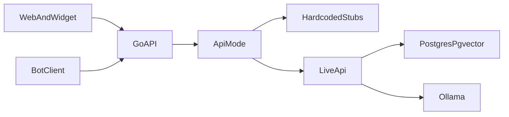

# DocsSearch

Локальный помощник по внутренним регламентам и документам. Прототип для кейса: сотрудник спрашивает своими словами, система находит положения инструкции, объясняет их простым языком и даёт ссылку на оригинал.

Исходное описание кейса лежит в [task.pdf](task.pdf).

## Задача

Сотрудник в диалоге:

- находит нужные разделы, пункты и приложения;
- получает понятное объяснение и точную цитату;
- видит процент релевантности и ссылку на оригинальный документ;
- отвечает на уточняющие вопросы, если запрос неполный;
- получает модульный бланк и заполняет его по шагам;
- загружает черновик и получает рекомендации по доработке;
- получает честный отказ, если в базе нет подходящих сведений.

Документы и запросы не уходят во внешние модели: и генерация, и эмбеддинги идут через локальную Ollama. В промпт попадают только фрагменты, которые пользователь имеет право видеть.

У документа есть редакция, и её можно заменить актуальной. Когда в материалах кейса появится матрица согласования, она загружается в базу как обычный источник и находится тем же поиском.

Конструктор собирает черновик по модульным бланкам из материалов кейса. Оформление полей берётся из бланка, в том числе если бланк ссылается на ГОСТ.

## Что входит в прототип

- RAG на Ollama: упрощённый ответ, цитата (документ, раздел, пункт, приложение), процент релевантности, ссылка на оригинал
- уточняющие вопросы и память диалога
- пользователи и уровни доступа к документам
- загрузка нового документа в базу
- конструктор бланка: вопросы по пустым полям и сборка черновика
- проверка загруженного черновика и рекомендации со ссылками на пункты
- фолбек, если подходящих фрагментов нет
- web-страница и попап-виджет на одном API
- журнал аудита: кто спросил и какие документы были показаны

## Что откладываем

- Десктоп-клиент. После рабочего web-прототипа, тот же API, каталог [source/electron](source/electron). Стек выберем позже
- витрина отличий между редакциями
- отдельный сценарий по матрице согласования
- гибридный поиск BM25 вместе с векторами

## Стек и модули

Зафиксированный стек есть только у ядра и RAG. Стек бота, сайта, виджета и десктоп-клиента выберем позже.

Бот и сайт - тонкие клиенты одного API. Сценарий диалога, поиск и сборка ответа живут в ядре, поэтому оба клиента получают одинаковые виды ответов.



- [source/core](source/core) - HTTP API на Go. Заглушки держат данные в памяти. В боевом режиме пользователи, сессии, реестр документов и журнал лежат в PostgreSQL, эмбеддинги и фильтр по уровню доступа - в той же базе через pgvector
- [source/RAG](source/RAG) - нарезка и эмбеддинги. Подключается при замене заглушек. Go-сервис ходит в Ollama по HTTP и пишет векторы в PostgreSQL
- [source/bot](source/bot) - клиент бота. Стек не выбран
- [source/web](source/web) - страница чата и попап-виджет для внутреннего портала. Стек не выбран. Свой Docker, отдельно от ядра
- [source/electron](source/electron) - десктоп-клиент после прототипа. Стек не выбран
- Docker ядра: `Dockerfile` и `docker-compose` в [source/core](source/core), сервисы только API и PostgreSQL с pgvector
- Ollama остаётся локальным процессом. Адрес и имена моделей задаются в `.env`

Переменные `.env`:

- `DEBUG` - подробные логи одной переменной
- `API_MODE` - `stub` или `live`
- `API_PORT` - порт HTTP, по умолчанию `8080`
- `DOCS_PASSWORD` - пароль страницы `/docs`, с которой можно отправлять запросы к API
- `DATABASE_URL` - строка подключения к PostgreSQL, нужна в `live`
- `OLLAMA_URL`, `OLLAMA_CHAT_MODEL`, `OLLAMA_EMBED_MODEL` - нужны в `live`

Тексты ответов и подписей лежат в отдельных файлах, не в обработчиках. Код пишем по [CodeStyle.md](CodeStyle.md): табы, комментарии на русском, идентификаторы на английском, дефис вместо длинного тире. В ядре на Go форматирование делает `gofmt`.

### Кто что делает

- ядро и замена заглушек - PotJoke
- сайт и виджет - Syharik3316, старт сразу после фазы 0
- бот - другие участники, старт сразу после фазы 0. Запись в [source/bot/README.md](source/bot/README.md), что бот ведёт PotJoke, устарела
- отдельного владельца RAG нет: модуль входит в трек API
- десктоп-клиент - общая ответственность, поздняя фаза, стек выберем позже

Фазы 2-6 идут параллельно с фазой 1. Клиенты продолжают ходить в те же эндпоинты, пока заглушки меняются на боевую реализацию. Форма ответов при этом не меняется.

Уровень доступа - целое число. Пользователь видит документ, если его уровень не ниже уровня документа. Список пользователей, создание, смена уровня и журнал доступны при уровне 2 и выше.

## Контракт API

Базовый префикс сервера задаёт окружение клиентов. Авторизация: заголовок `Authorization: Bearer <token>`. Поле `token` - случайная строка текущего процесса.

Ошибки, одинаковые для `stub` и `live`:

- `401` и `{"error":"invalid_credentials"}` - неверная пара логина и пароля
- `401` и `{"error":"unauthorized"}` - нет заголовка или токен неизвестен
- `403` и `{"error":"access_denied"}` - уровень ниже нужного, чужая сессия или закрытый файл
- `404` и `{"error":"not_found"}` - нет такой сессии, пользователя или документа
- `409` и `{"error":"login_taken"}` - логин уже занят
- `400` и `{"error":"invalid_body"}` - тело запроса не разбирается
- `501` и `{"error":"live_not_ready"}` - `API_MODE=live`, боевая реализация ещё не включена

Локальным клиентам сервер отвечает с CORS на любой origin и разрешает заголовки `Authorization` и `Content-Type`.

### `POST /auth/login`

Запрос:

```json
{ "login": "user", "password": "user" }
```

Ответ:

```json
{
  "token": "a1b2c3d4e5f67890",
  "userId": "user-1",
  "displayName": "Сотрудник",
  "accessLevel": 1
}
```

Значение `token` в примере условное: на каждом входе сервер выдаёт новое.

### `GET /me`

Тот же объект пользователя, без поля `token`.

### `POST /sessions`

Ответ:

```json
{ "sessionId": "session-1" }
```

Сессия принадлежит вошедшему пользователю.

### `GET /sessions/{sessionId}`

История этой сессии. Реплика пользователя содержит `role` и `text`. Ответ ассистента содержит те же поля, что `POST .../messages`, плюс `role: "assistant"`.

```json
{
  "sessionId": "session-1",
  "messages": [
    {
      "role": "user",
      "text": "Как зарегистрировать входящий документ?"
    },
    {
      "role": "assistant",
      "kind": "answer",
      "text": "Входящий документ регистрируют в день поступления и присваивают ему номер.",
      "relevancePercent": 86,
      "citations": []
    }
  ]
}
```

### `POST /sessions/{sessionId}/messages`

Запрос:

```json
{ "text": "Как зарегистрировать входящий документ?" }
```

Ответ ассистента. Поле `kind`:

- `answer` - объяснение, цитаты, процент релевантности
- `clarify` - уточняющий вопрос
- `fallback` - в базе нет подходящих сведений
- `template_field` - вопрос по очередному полю бланка
- `template_ready` - черновик собран
- `access_denied` - на найденные документы не хватает уровня доступа

Пример `answer`:

```json
{
  "kind": "answer",
  "text": "Входящий документ регистрируют в день поступления и присваивают ему номер.",
  "relevancePercent": 86,
  "citations": [
    {
      "document": "Инструкция по документообороту",
      "edition": "1.0",
      "section": "3",
      "paragraph": "3.2",
      "appendix": "",
      "quote": "Точная цитата из пункта инструкции.",
      "originalLink": "/documents/doc-1/file#p3.2"
    }
  ]
}
```

Пример `template_field`:

```json
{
  "kind": "template_field",
  "text": "Укажите адресата.",
  "relevancePercent": 0,
  "citations": [],
  "template": {
    "id": "memo",
    "title": "Служебная записка",
    "field": "addressee",
    "fieldLabel": "Адресат"
  }
}
```

Пример `template_ready`:

```json
{
  "kind": "template_ready",
  "text": "Черновик собран.",
  "relevancePercent": 0,
  "citations": [],
  "template": {
    "id": "memo",
    "title": "Служебная записка",
    "draftText": "Текст черновика."
  }
}
```

У `clarify`, `fallback` и `access_denied` те же поля `text`, `relevancePercent` и `citations`. Для отказа и фолбека список цитат пустой, процент равен 0.

### `POST /documents`

Загрузка нового документа в базу знаний: `multipart/form-data`, поле `file`. Необязательные поля `title`, `edition`, `accessLevel`.

Ответ:

```json
{
  "documentId": "doc-1",
  "status": "accepted",
  "edition": "1.0"
}
```

Повторная загрузка с тем же названием и новой редакцией заменяет актуальную редакцию. В заглушке файл не индексируется, но запись появляется в списке.

### `GET /documents`

Документы, которые текущий пользователь имеет право видеть.

```json
{
  "documents": [
    {
      "documentId": "doc-1",
      "title": "Инструкция по документообороту",
      "edition": "1.0",
      "accessLevel": 1
    }
  ]
}
```

### `GET /documents/{documentId}/file`

Файл оригинала. В цитатах `originalLink` ведёт на этот путь, якорь пункта остаётся фрагментом: `/documents/doc-1/file#p3.2`.

### `GET /users`

Список учётных записей. Нужен уровень 2 или выше.

```json
{
  "users": [
    {
      "userId": "user-1",
      "login": "user",
      "displayName": "Сотрудник",
      "accessLevel": 1
    }
  ]
}
```

### `POST /users`

Создание учётной записи. Нужен уровень 2 или выше. Пароль в ответ не входит.

Запрос:

```json
{
  "login": "clerk",
  "password": "clerk",
  "displayName": "Делопроизводитель",
  "accessLevel": 1
}
```

Ответ - объект пользователя, как элемент списка `GET /users`.

### `PATCH /users/{userId}`

Смена `displayName` и `accessLevel`. Нужен уровень 2 или выше. Можно передать одно поле или оба.

```json
{ "displayName": "Сотрудник архива", "accessLevel": 1 }
```

Ответ - обновлённый объект пользователя.

### `GET /audit`

Журнал от старых записей к новым. Нужен уровень 2 или выше. Каждое сообщение в сессии добавляет строку: кто спросил, текст, время, какие документы показаны.

```json
{
  "entries": [
    {
      "entryId": "audit-1",
      "userId": "user-1",
      "displayName": "Сотрудник",
      "question": "Как зарегистрировать входящий документ?",
      "createdAt": "2026-10-23T14:00:00Z",
      "documents": [
        {
          "documentId": "doc-1",
          "title": "Инструкция по документообороту",
          "paragraph": "3.2"
        }
      ]
    }
  ]
}
```

### `POST /drafts/check`

Проверка черновика: `multipart/form-data`, поле `file`.

Ответ:

```json
{
  "recommendations": [
    {
      "text": "В проекте нет отметки о приложении.",
      "citation": {
        "document": "Инструкция по документообороту",
        "edition": "1.0",
        "section": "4",
        "paragraph": "4.1",
        "appendix": "",
        "quote": "Точная цитата требования.",
        "originalLink": "/documents/doc-1/file#p4.1"
      }
    }
  ]
}
```

## Режим заглушек

При `API_MODE=stub` сервер не вызывает Ollama и не читает базу. Сессии, документы, пользователи и журнал лежат в памяти, пока жив процесс. После перезапуска остаются две учётные записи и два документа:

- `admin` / `admin`, `userId` `user-admin`, уровень 2
- `user` / `user`, `userId` `user-1`, уровень 1
- `doc-1` - «Инструкция по документообороту», уровень 1
- `doc-2` - «Закрытый регламент», уровень 2

Вид ответа на сообщение выбирается фразой, регистр не важен:

- текст содержит `нет доступа` - `access_denied`
- текст содержит `не найдено` - `fallback`
- текст содержит `уточни` - `clarify`
- текст содержит `шаблон` - первый такой ответ в сессии: `template_field`, следующий ответ в этой сессии: `template_ready`
- любое другое сообщение - `answer` с фиксированными цитатой, ссылкой и процентом релевантности

`POST /drafts/check` возвращает один фиксированный пункт рекомендаций.

Запуск из каталога [source/core](source/core): скопировать `.env.example` в `.env`, задать `DOCS_PASSWORD` и выполнить `go run ./cmd/api`. Страница проверки запросов: `/docs`.

Для показа жюри нужен `API_MODE=live`. В фазе 0 этот режим отвечает `501`.

## Фазы

Контракт выше появляется целиком в фазе 0. В фазах 2-6 меняется только реализация, формы ответов остаются прежними.

### Фаза 0. Заглушки ядра

Цель: отдать боту и сайту стабильные эндпоинты, пока делается боевой API.

Объём: Go-сервер в [source/core](source/core). Кто: PotJoke.

- [x] Сервер отдаёт контракт из этого README
- [x] Заглушки `answer`, `clarify`, `fallback`, `template_field`, `template_ready`, `access_denied`
- [x] История сессии, список документов и файл оригинала
- [x] Пользователи и журнал аудита
- [x] При `API_MODE=live` методы отвечают `501`
- [x] Страница `/docs` закрыта паролем `DOCS_PASSWORD`

### Фаза 1. Клиенты

Цель: собрать интерфейсы демо на фиктивных данных.

Объём: клиенты ходят только в контракт фазы 0. Фаза идёт параллельно с фазами 2-6. Кто: сайт и виджет - Syharik3316, бот - другие участники.

- [ ] Страница чата в [source/web](source/web)
- [ ] Попап-виджет для внутреннего портала
- [ ] Клиент бота в [source/bot](source/bot)
- [ ] Отдельный Docker сайта в [source/web](source/web): свой compose, без контейнеров ядра

### Фаза 2. База знаний

Цель: заменить заглушку загрузки живой индексацией.

Объём: инструкция и бланки попадают в PostgreSQL. Кто: PotJoke.

- [ ] PostgreSQL для пользователей, сессий, реестра документов и журнала
- [ ] Расширение pgvector для эмбеддингов и фильтра по уровню доступа
- [ ] Docker ядра в [source/core](source/core): `Dockerfile` и `docker-compose` только с API и PostgreSQL
- [ ] Нарезка файлов на фрагменты с метаданными: документ, редакция, раздел, пункт, приложение, уровень доступа
- [ ] Эмбеддинги через локальную Ollama
- [ ] Повторная загрузка с тем же названием меняет актуальную редакцию
- [ ] `POST /documents` в боевом режиме индексирует файл, и он находится поиском

### Фаза 3. Боевой ответ

Цель: заменить заглушки `answer`, `clarify` и `fallback`.

Объём: ответ собирается только из найденных фрагментов. Кто: PotJoke.

- [ ] Обычный вопрос возвращает пересказ, цитату, процент релевантности и ссылку на оригинал
- [ ] Неоднозначный вопрос получает `clarify`
- [ ] Вопрос вне базы получает `fallback` и не достраивает факты
- [ ] Сессия помнит предыдущие реплики

### Фаза 4. Доступ и аудит

Цель: заменить постоянных пользователей заглушки учётом ролей в PostgreSQL.

Объём: фильтр выдачи до сборки промпта и запись показанных документов. Кто: PotJoke.

- [ ] Учётные записи и уровни доступа читаются из PostgreSQL
- [ ] В промпт попадают только фрагменты не выше уровня пользователя
- [ ] `access_denied`, когда подходящие фрагменты есть только в закрытых документах
- [ ] Два пользователя с разным уровнем получают разную выдачу на один вопрос
- [ ] Журнал пишет, кто спросил и какие документы показаны

### Фаза 5. Конструктор

Цель: заменить заглушки `template_field` и `template_ready`.

Объём: черновик собирается по модульному бланку. Кто: PotJoke.

- [ ] По запросу находится подходящий бланк
- [ ] Система задаёт вопросы по пустым полям
- [ ] После ответов отдаёт `draftText`

### Фаза 6. Проверка черновика

Цель: заменить фиксированные рекомендации `POST /drafts/check`.

Объём: загруженный проект сверяется с инструкцией. Кто: PotJoke.

- [ ] Черновик с пропуском обязательного реквизита получает рекомендацию
- [ ] У рекомендации есть цитата и ссылка на пункт

### Фаза 7. Сдача

Цель: закрыть обязательные материалы защиты.

Объём: тексты пишет вся команда по своим модулям. Десктоп-клиент в эту фазу не входит.

- [ ] Описание архитектуры и стека ядра и RAG
- [ ] Пользовательские сценарии
- [ ] Схема работы с инструкцией и базой
- [ ] Описание поиска и формирования ответа
- [ ] Способы снижения ошибочных ответов
- [ ] Подход к доступу и защите данных
- [ ] Как подключать новые инструкции и бланки
- [ ] Сценарий демонстрации ниже проходит на `API_MODE=live`

## Чеклист демонстрации

- сотрудник формулирует задачу своими словами - фазы 1 и 3
- система определяет релевантные положения инструкции - фаза 3
- ответ содержит ссылки на источники и процент релевантности - фазы 0 и 3
- помощник уточняет недостающую информацию - фазы 0 и 3
- пользователь получает нужный бланк - фазы 0 и 5
- система заполняет бланк уточняющими вопросами - фазы 0 и 5
- при нехватке сведений система прямо говорит, что в базе этого нет - фазы 0 и 3
