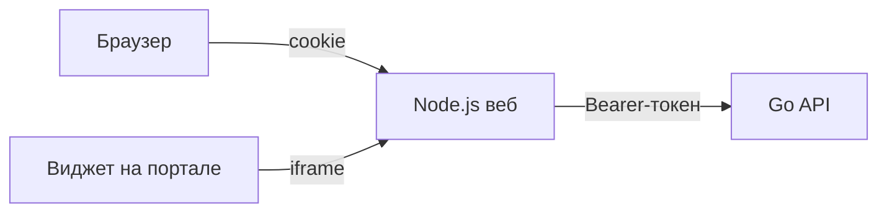

отвественность Syharik3316

# Веб DocsSearch

Страница чата и попап-виджет для внутреннего портала. Тонкий клиент API ядра: сценарий диалога, поиск и сборка ответа живут в [source/core](../core).

- HTML, CSS и JavaScript без сборки и фреймворков
- Node.js без npm-зависимостей: только встроенные модули
- Внешних запросов нет: ни CDN, ни шрифтов, ни аналитики
- Интерфейс по образцу open-webui: боковая панель с чатами, лента по центру, источники под ответом, админ-панель

## Запуск

Нужен Node.js 22 или новее и запущенное ядро.

```bash
cp .env.example .env
npm start
```

Страница открывается на `http://localhost:3000`. В режиме заглушек ядра есть учётные записи `user` / `user` и `admin` / `admin`. С `STUB_SEED_USERS=false` в `.env` ядра их нет, и сайт сразу показывает первый запуск.

- `npm run dev` - перезапуск сервера при правке файлов в `server/`
- `npm run check` - тесты сервера против тестового ядра

## Как устроено



Браузер ходит только в `/api` своего веб-сервера. Токен ядра хранится на веб-сервере (схема BFF), браузер получает случайный идентификатор в httpOnly-cookie. Скрипты страницы и портала токен не видят.

- `POST /api/auth/login`, `POST /api/auth/signup`, `POST /api/auth/ldap`, `GET /api/auth/session`, `POST /api/auth/logout` обрабатывает сам веб-сервер: токен ядра из ответа остаётся в его сессии
- `GET /api/auth/config` без сессии говорит экрану входа, нужен ли первый запуск и включены ли регистрация и LDAP
- `/api/auth/admin/*` - настройки входа администратора, уходят в ядро с токеном сессии
- остальные `/api/*` уходят в ядро потоком: JSON, файлы `multipart/form-data`, скачивание оригиналов
- в ядро пропускаются только разделы контракта: `me`, `sessions`, `documents`, `users`, `audit`, `drafts`, `templates`, `blanks`, `processes`, `roles`, `permissions`, `ai`, `organization`, `sources`. Вход ядра и его страница `/docs` из браузера недоступны
- запросы, которые меняют данные, требуют CSRF-токен сессии и свой origin
- вход, регистрация и вход через LDAP ограничены по числу неудачных попыток с одного адреса
- страницы отдаются со строгим CSP: всё только со своего origin
- DOM собирается без `innerHTML`, текст ответов попадает в страницу только через `textContent`

Роли как в open-webui: администратор, пользователь и ожидающий подтверждения. Ядро отдаёт поле `role`, для старого ядра без него роль считается по уровню и порогу `ADMIN_ACCESS_LEVEL`. Ожидающий подтверждения видит только экран «Учётная запись ожидает активации». Менять логику ролей нужно только в [public/js/roles.js](public/js/roles.js).

## Экраны

- `/login` - вход по почте, регистрация, «Продолжить через LDAP» и первый запуск с созданием администратора
- `/` - новый чат, `/c/<sessionId>` - открытый чат. Под полем ввода - переключатель режима «Чтение» / «План» (поле `mode` сообщения, режим из истории сессии, новый чат берет последний выбор); без права `templates.use` переключателя нет и чат отвечает только по базе знаний. В меню чата на боковой панели любой пользователь переименовывает, закрепляет и удаляет свои чаты. Переименование и удаление включаются флагами `canRename` и `canDelete` из `GET /sessions`, закрепление хранится в браузере
- `/documents` - документы базы знаний: свои личные (загрузка, новая редакция, удаление) и общие (просмотр)
- `/admin/users`, `/admin/knowledge`, `/admin/audit`, `/admin/settings`, `/admin/sources` - админ-панель, только для администраторов. В «Базе знаний» администратор управляет общими документами и видит личные документы всех сотрудников, в «Пользователях» добавляет, правит и удаляет учётные записи (себя удалить нельзя, вместе с учётной записью уходят её чаты, черновики и личные документы), в «Настройках» - регистрацией, ролью по умолчанию и LDAP, в «Источниках» (флаг `sources.manage`) включает автозагрузку из папки или лицензионного API
- `/embed` - компактный чат для iframe виджета
- `/widget-demo.html` - пример страницы портала с подключённым виджетом

Ответ ассистента рисуется по полю `kind`: `answer` с релевантностью и источниками, `clarify`, `fallback`, `access_denied`, `template_field`, `template_ready`, `draft_revision`. У `answer` и `fallback` есть блок «Куда обратиться», если ядро прислало `contacts`. Незнакомый `kind` показывается как обычный ответ. Вопросы ассистента (`clarify`, `template_choice`, `template_field`) не идут в ленту: над полем ввода открывается карточка вопросов, как в Claude Code (`components/question-card.js`), а поле ввода прячется. Один вопрос (уточнение, выбор документа): варианты из `options` нажимаются или выбираются цифрой, свой ответ - Enter, уточнение пропускается кнопкой или Esc. Вопросы документа из `template.questions` идут «в строку»: шаги по полям, «Назад» и «Далее», «Пропустить» у необязательных, в конце «Проверьте ответы» и одна отправка - текст для ленты плюс `answers` (`[{ field, value }]`). «Отменить» останавливает документ. После ответа вопросы и ответы сворачиваются в ленте в блок «вопрос -> ответ», вопросы без ответа - в блок с пометкой «Без ответа». Новый ответ ассистента проявляется по словам (`lib/reveal.js`), карточки и источники появляются после текста; при `prefers-reduced-motion` и в фоновой вкладке ответ виден сразу. Кнопка «+» предлагает «Проверить по инструкции» и «Помочь с черновиком», если на это есть флаги `drafts.check` и `drafts.assist`. Разделы админ-панели и действия берутся из `permissions` в `GET /me`.

## Общие и личные документы

База знаний одна. Общие документы загружает администратор, их видят все сотрудники с подходящим уровнем. Личные документы загружает любой сотрудник для себя: их видят владелец и администраторы, а ищет по ним чат только самого владельца. Цитата из личного документа помечается в чате и в журнале.

Что можно делать, решает ядро: флаги `canUploadGlobal`, `canUploadPersonal` в `GET /documents` и `canDelete` у документа. Веб показывает только разрешённые действия. Если ядро этих полей не отдаёт, загрузка личных документов выключена: старое ядро сохранило бы такой файл общим. Контракт описан в README репозитория.

## Виджет на портале

```html
<script src="https://адрес-веба/widget.js" defer></script>
```

Необязательно: `data-position="left"`, `data-label="Подпись кнопки"`. Кнопка живёт в закрытом Shadow DOM, чат открывается в iframe с `/embed`.

Если портал на другом домене:

- адрес портала добавить в `EMBED_ALLOWED_ORIGINS`
- включить HTTPS, `COOKIE_SECURE=true` и `COOKIE_SAMESITE=None`

## Переменные `.env`

| Переменная | Что задаёт |
|---|---|
| `DEBUG` | лог каждого запроса без строки параметров |
| `WEB_HOST`, `WEB_PORT` | где слушает веб |
| `CORE_API_URL` | адрес ядра |
| `CORE_API_URL_DOCKER` | адрес ядра для `docker compose`, по умолчанию ядро на хосте |
| `CORE_TIMEOUT_MS` | сколько ждать ответ ядра |
| `ADMIN_ACCESS_LEVEL`, `USER_ACCESS_LEVEL` | уровни ядра для двух ролей |
| `SESSION_TTL_MINUTES` | время жизни сессии без активности |
| `COOKIE_SECURE`, `COOKIE_SAMESITE` | режим cookie |
| `EMBED_ALLOWED_ORIGINS` | порталы, которым можно встраивать виджет |
| `MAX_UPLOAD_MB` | предел размера файла |
| `ALLOWED_UPLOAD_EXTENSIONS` | форматы файлов, которые принимает ядро: `.txt .pdf .docx` |
| `LOGIN_MAX_ATTEMPTS`, `LOGIN_WINDOW_MINUTES` | защита входа от перебора |

## Docker

Свой compose, без контейнеров ядра:

```bash
cp .env.example .env
docker compose up -d --build
```

Контейнер запускается от пользователя `node`, с файловой системой только для чтения и без capabilities.

## Что ждём от ядра

Интерфейс готов к этим методам и включит их сам, как только они появятся. Фейковых данных вместо них клиент не подставляет.

- общие и личные документы: `scope`, `ownerId`, флаги прав, `DELETE /documents/{documentId}`, фильтр поиска по владельцу (фаза 4 в README репозитория)
- позже: потоковый ответ
