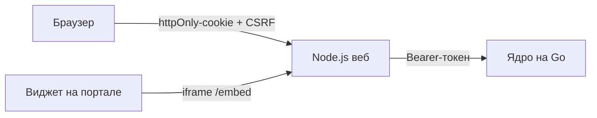

# Веб DocsSearch

Страница чата, админ-панель и виджет для внутреннего портала. Тонкий клиент [ядра](../core): поиск, ответы и права живут там, веб показывает их и защищает сессию.

Ответственный: Syharik3316.

- HTML, CSS и JavaScript без сборки и фреймворков
- Node.js без npm-зависимостей, только встроенные модули
- Никаких внешних запросов: ни CDN, ни шрифтов, ни аналитики
- Интерфейс по образцу open-webui: чаты слева, лента по центру, источники под ответом

## Запуск

Нужен Node.js 22 или новее и запущенное ядро (для интерфейса без базы хватит ядра с `API_MODE=stub`).

```bash
cp .env.example .env
npm start
```

Откройте http://localhost:3000. С ядром-заглушкой вход `admin` / `admin` или `user` / `user`.

| Команда | Что делает |
|---|---|
| `npm start` | запуск сервера |
| `npm run dev` | перезапуск при правке файлов в `server/` |
| `npm run check` | тесты сервера против тестового ядра (`test/server.test.js`) |

Отдельный Docker без ядра: `docker compose up -d --build` в этом каталоге, адрес ядра - `CORE_API_URL_DOCKER`. Контейнер работает от пользователя `node`, с файловой системой только для чтения и без capabilities.

## Как устроено



Схема BFF: токен ядра хранится только на веб-сервере, браузер получает случайный идентификатор сессии в httpOnly-cookie. Скрипты страницы и портала токен не видят.

- Вход, регистрацию, вход через LDAP, сессию и выход (`/api/auth/*`) обрабатывает сам веб-сервер.
- Остальные `/api/*` уходят в ядро потоком, включая загрузку и скачивание файлов. Пропускаются только разделы контракта: `me`, `sessions`, `documents`, `users`, `audit`, `drafts`, `templates`, `blanks`, `processes`, `roles`, `permissions`, `ai`, `organization`, `sources`, а также `/auth/admin/*`. Вход ядра и страница `/docs` из браузера недоступны.

## Безопасность

- Меняющие запросы требуют CSRF-токен сессии и свой origin (или origin из `EMBED_ALLOWED_ORIGINS`).
- Вход и регистрация ограничены числом неудачных попыток с одного адреса (`LOGIN_MAX_ATTEMPTS` за `LOGIN_WINDOW_MINUTES`).
- Страницы со строгим CSP: всё только со своего origin, встраивать в чужие сайты нельзя, кроме `/embed` для разрешённых порталов. Ответы `/api` с CSP `default-src 'none'; sandbox`.
- DOM собирается без `innerHTML` (`public/js/lib/dom.js`): данные из API попадают в страницу только через `textContent`. Ссылки на файлы пропускаются только на `/documents/`, `/blanks/` и `/drafts/`.
- Тело запроса ограничено `MAX_UPLOAD_MB`, статика не выходит за пределы `public/`.

## Экраны

| Адрес | Что там |
|---|---|
| `/login` | вход по почте, регистрация, вход через LDAP, создание первого администратора |
| `/`, `/c/<sessionId>` | новый и открытый чат |
| `/documents` | документы базы знаний: свои личные и общие |
| `/admin/...` | админ-панель: пользователи, роли, база знаний, журнал, модели ИИ, организация, настройки, источники |
| `/embed` | компактный чат для iframe виджета |
| `/widget-demo.html` | пример страницы портала с виджетом |

Что показать, решает ядро: разделы админ-панели и кнопки берутся из `permissions` в `GET /me` и флагов `canUploadGlobal`, `canDelete`, `canRename` в ответах. Ожидающий подтверждения видит только экран «Учётная запись ожидает активации». Логика ролей собрана в [public/js/roles.js](public/js/roles.js).

### Чат

- Переключатель «Чтение» / «План» под полем ввода: ответы по базе знаний или подготовка документа. Без права `templates.use` переключателя нет.
- Ответ рисуется по полю `kind`: `answer` с релевантностью и источниками, `fallback`, `access_denied`, `template_ready` и `draft_revision` с текстом и `.docx`. Незнакомый `kind` показывается как обычный ответ.
- Вопросы ассистента (`clarify`, `template_choice`, `template_field`) открываются карточкой над полем ввода ([components/question-card.js](public/js/components/question-card.js)): варианты кликом или цифрой, свой ответ - Enter, шаги «Назад» и «Далее», проверка ответов и одна отправка. В ленте вопросы сворачиваются в блок «вопрос -> ответ».
- Ответ проявляется по словам ([lib/reveal.js](public/js/lib/reveal.js)), при `prefers-reduced-motion` и в фоновой вкладке - сразу целиком.
- Кнопка «+» - «Проверить по инструкции» и «Помочь с черновиком», если есть права `drafts.check` и `drafts.assist`.
- Чаты можно переименовать, закрепить и удалить. Закрепление хранится в браузере.

## Виджет на портале

```html
<script src="https://адрес-веба/widget.js" defer></script>
```

Необязательно: `data-position="left"`, `data-label="Подпись кнопки"`. Кнопка живёт в закрытом Shadow DOM, чат открывается в iframe с `/embed` и принимает команды только от своего iframe.

Если портал на другом домене: добавить его в `EMBED_ALLOWED_ORIGINS`, включить HTTPS, `COOKIE_SECURE=true` и `COOKIE_SAMESITE=None`.

## Переменные `.env`

| Переменная | Что задаёт | По умолчанию |
|---|---|---|
| `DEBUG` | лог каждого запроса без строки параметров | `false` |
| `WEB_HOST`, `WEB_PORT` | где слушает веб | `0.0.0.0`, `3000` |
| `CORE_API_URL` | адрес ядра (обязателен) | `http://localhost:8080` |
| `CORE_API_URL_DOCKER` | адрес ядра для compose этого каталога | ядро на хосте |
| `CORE_TIMEOUT_MS` | сколько ждать ответ ядра | `120000` |
| `ADMIN_ACCESS_LEVEL`, `USER_ACCESS_LEVEL` | уровни ядра для ролей, если ядро не прислало `role` | `2`, `1` |
| `SESSION_TTL_MINUTES` | жизнь сессии без активности | `480` |
| `COOKIE_SECURE`, `COOKIE_SAMESITE` | режим cookie; `None` требует `Secure` | `false`, `Lax` |
| `EMBED_ALLOWED_ORIGINS` | порталы для виджета, через пробел | пусто |
| `MAX_UPLOAD_MB` | предел размера файла | `20` |
| `ALLOWED_UPLOAD_EXTENSIONS` | форматы, которые принимает ядро | `.txt .pdf .docx` |
| `LOGIN_MAX_ATTEMPTS`, `LOGIN_WINDOW_MINUTES` | защита входа от перебора | `10`, `15` |

## Где что лежит

| Путь | Что внутри |
|---|---|
| `server/index.js` | точка входа, маршрутизация |
| `server/api.js` | вход, сессии, прокси в ядро |
| `server/security.js` | заголовки безопасности, origin, CSRF, ограничение попыток |
| `public/js/views` | экраны: чат, документы, вкладки админ-панели |
| `public/js/components` | сообщения, карточка вопросов, загрузка файлов, боковая панель |
| `public/js/texts.js` | все тексты интерфейса и сообщения об ошибках |
| `public/widget.js` | загрузчик виджета для портала |
