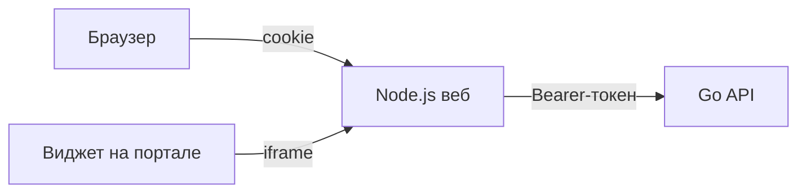

отвественность Syharik3316

# Веб DocsSearch

Страница чата и попап-виджет для внутреннего портала. Тонкий клиент API ядра: сценарий диалога, поиск и сборка ответа живут в [source/core](../core).

- HTML, CSS и JavaScript без сборки и фреймворков
- Node.js без npm-зависимостей: только встроенные модули
- Внешних запросов нет: ни CDN, ни шрифтов, ни аналитики
- Интерфейс по образцу open-webui: боковая панель с чатами, лента по центру, источники под ответом, админ-панель

## Запуск

Нужен Node.js 22 или новее и запущенное ядро.

```bash
cp .env.example .env
npm start
```

Страница открывается на `http://localhost:3000`. В режиме заглушек ядра есть учётные записи `user` / `user` и `admin` / `admin`.

- `npm run dev` - перезапуск сервера при правке файлов в `server/`
- `npm run check` - тесты сервера против тестового ядра

## Как устроено



Браузер ходит только в `/api` своего веб-сервера. Токен ядра хранится на веб-сервере (схема BFF), браузер получает случайный идентификатор в httpOnly-cookie. Скрипты страницы и портала токен не видят.

- `POST /api/auth/login`, `GET /api/auth/session`, `POST /api/auth/logout` обрабатывает сам веб-сервер
- остальные `/api/*` уходят в ядро потоком: JSON, файлы `multipart/form-data`, скачивание оригиналов
- в ядро пропускаются только разделы контракта: `me`, `sessions`, `documents`, `users`, `audit`, `drafts`, `templates`. Вход ядра и его страница `/docs` из браузера недоступны
- запросы, которые меняют данные, требуют CSRF-токен сессии и свой origin
- вход ограничен по числу попыток с одного адреса
- страницы отдаются со строгим CSP: всё только со своего origin
- DOM собирается без `innerHTML`, текст ответов попадает в страницу только через `textContent`

Роли две: администратор и пользователь. Ядро отдаёт числовой уровень, порог администратора задаёт `ADMIN_ACCESS_LEVEL`. Если ядро начнёт отдавать поле `role`, клиент возьмёт его, менять нужно только [public/js/roles.js](public/js/roles.js).

## Экраны

- `/login` - вход
- `/` - новый чат, `/c/<sessionId>` - открытый чат
- `/admin/users`, `/admin/knowledge`, `/admin/audit` - админ-панель, только для администраторов
- `/embed` - компактный чат для iframe виджета
- `/widget-demo.html` - пример страницы портала с подключённым виджетом

Ответ ассистента рисуется по полю `kind`: `answer` с релевантностью и источниками, `clarify`, `fallback`, `access_denied`, `template_field`, `template_ready`. Незнакомый `kind` показывается как обычный ответ. Черновик на проверку прикрепляется кнопкой «+» или перетаскиванием в окно чата.

## Виджет на портале

```html
<script src="https://адрес-веба/widget.js" defer></script>
```

Необязательно: `data-position="left"`, `data-label="Подпись кнопки"`. Кнопка живёт в закрытом Shadow DOM, чат открывается в iframe с `/embed`.

Если портал на другом домене:

- адрес портала добавить в `EMBED_ALLOWED_ORIGINS`
- включить HTTPS, `COOKIE_SECURE=true` и `COOKIE_SAMESITE=None`

## Переменные `.env`

| Переменная | Что задаёт |
|---|---|
| `DEBUG` | лог каждого запроса без строки параметров |
| `WEB_HOST`, `WEB_PORT` | где слушает веб |
| `CORE_API_URL` | адрес ядра |
| `CORE_API_URL_DOCKER` | адрес ядра для `docker compose`, по умолчанию ядро на хосте |
| `CORE_TIMEOUT_MS` | сколько ждать ответ ядра |
| `ADMIN_ACCESS_LEVEL`, `USER_ACCESS_LEVEL` | уровни ядра для двух ролей |
| `SESSION_TTL_MINUTES` | время жизни сессии без активности |
| `COOKIE_SECURE`, `COOKIE_SAMESITE` | режим cookie |
| `EMBED_ALLOWED_ORIGINS` | порталы, которым можно встраивать виджет |
| `MAX_UPLOAD_MB` | предел размера файла |
| `ALLOWED_UPLOAD_EXTENSIONS` | форматы файлов, которые принимает ядро: `.txt .pdf .docx` |
| `LOGIN_MAX_ATTEMPTS`, `LOGIN_WINDOW_MINUTES` | защита входа от перебора |

## Docker

Свой compose, без контейнеров ядра:

```bash
cp .env.example .env
docker compose up -d --build
```

Контейнер запускается от пользователя `node`, с файловой системой только для чтения и без capabilities.

## Что ждём от ядра

Интерфейс готов к этим методам и включит их сам, как только они появятся. Фейковых данных вместо них клиент не подставляет.

- позже: переименование и удаление сессии, потоковый ответ
